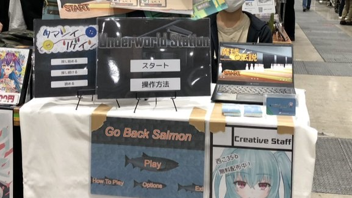
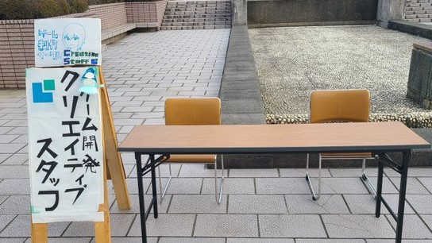
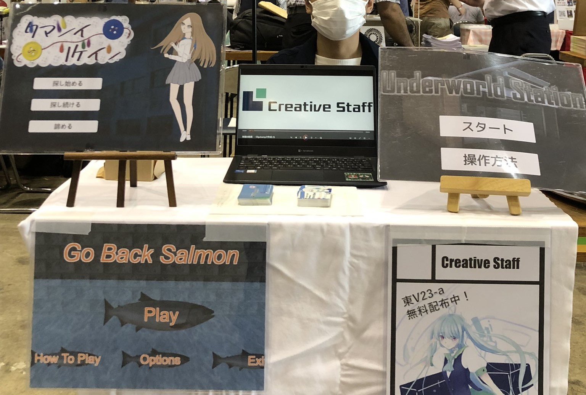
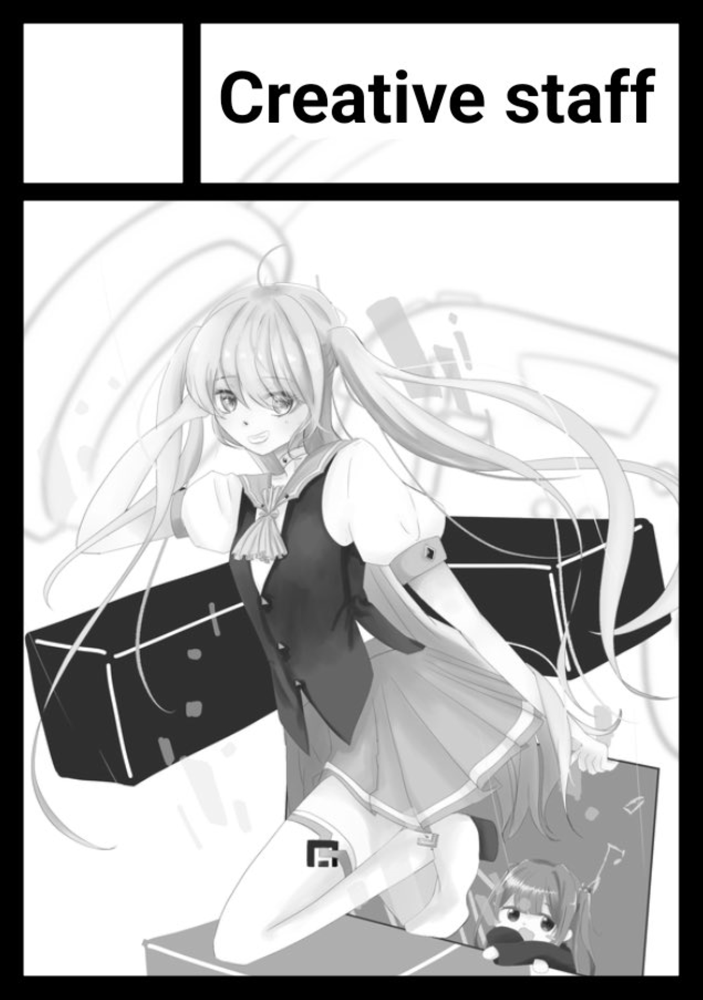
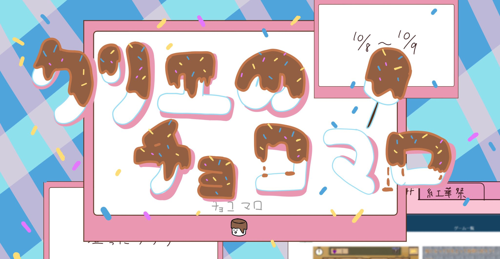
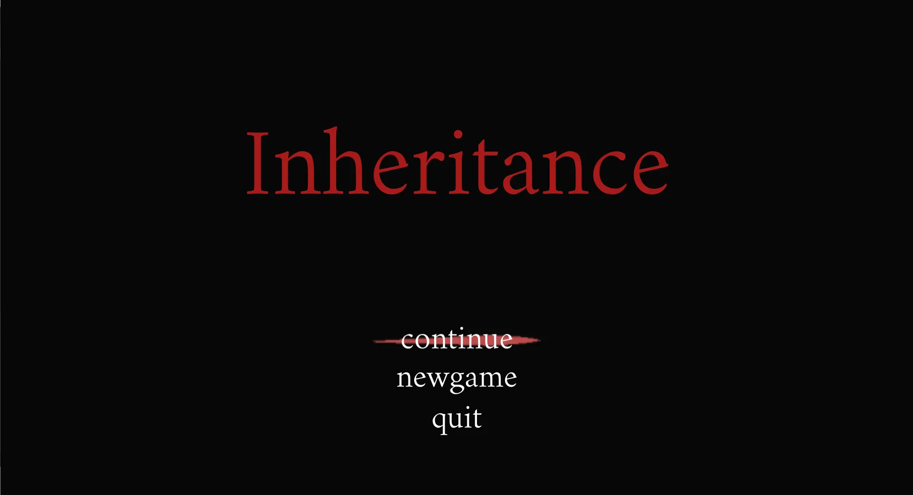
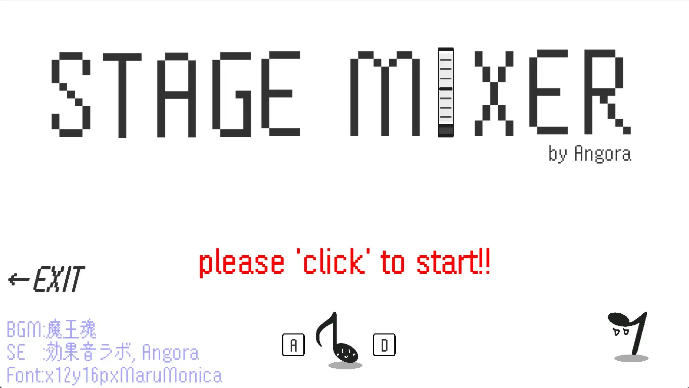
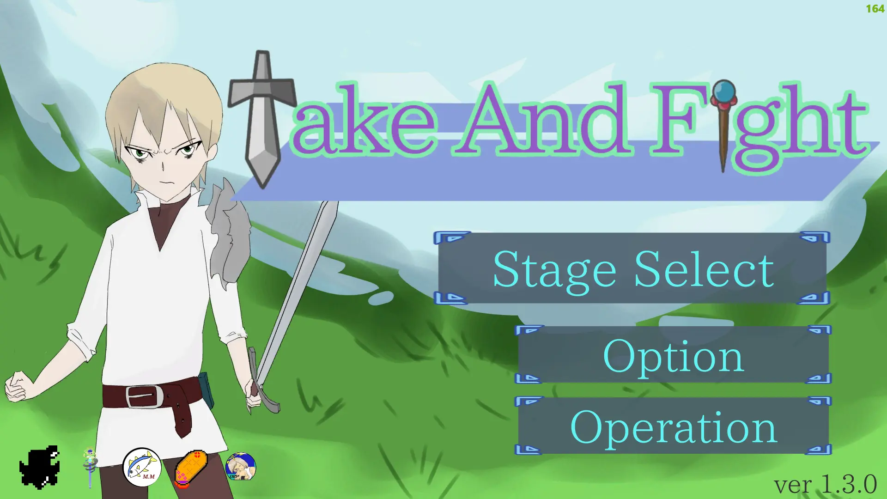

Project Path: creative-staff.github.io

Source Tree:

```txt
creative-staff.github.io
├── CNAME
├── about
│   ├── about.css
│   ├── about.html
│   ├── cgls
│   │   └── Rinen.webp
│   ├── event.html
│   └── history.html
├── articles
│   ├── 20221231_c101
│   │   ├── 1.webp
│   │   └── article.html
│   ├── 20230404_shinkanreport23
│   │   ├── 1.webp
│   │   └── article.html
│   ├── 20230405_newHP
│   │   └── article.html
│   ├── 20230410_circleinfo
│   │   └── article.html
│   ├── 20230509_circleinfo2
│   │   └── article.html
│   ├── 20230522_23tourokukai
│   │   └── article.html
│   ├── 20240324_23nokiseki
│   │   ├── 1.webp
│   │   ├── 2.webp
│   │   ├── 3.webp
│   │   └── article.html
│   ├── 20240324_24shinkan
│   │   ├── 1.webp
│   │   └── article.html
│   ├── 20240412_24setsumeikai
│   │   └── article.html
│   ├── 20240506_24tourokukai
│   │   └── article.html
│   ├── 20240519_24aftertourokukai
│   │   └── article.html
│   ├── 20251205_introduction
│   │   └── article.html
│   ├── article.css
│   └── articles.json
├── articles_backup
│   ├── 20221231_c101
│   │   ├── article.html
│   │   └── cgls
│   │       └── comike101.jpg
│   ├── 20230404_shinkanreport23
│   │   ├── article.html
│   │   └── cgls
│   │       └── shinkan2023.jpg
│   ├── 20230405_newHP
│   │   └── article.html
│   ├── 20230410_circleinfo
│   │   └── article.html
│   ├── 20230509_circleinfo2
│   │   └── article.html
│   ├── 20230522_23tourokukai
│   │   └── article.html
│   ├── 20240324_23nokiseki
│   │   ├── article.html
│   │   └── cgls
│   │       ├── 2023CC.jpg
│   │       ├── Topic_2023NOKISEKI.webp
│   │       ├── comike102.jpg
│   │       └── koukasai2023.jpg
│   ├── 20240324_24shinkan
│   │   ├── article.html
│   │   └── cgls
│   │       ├── 2024SHINKAN_map.webp
│   │       └── Topic_notice_2024SHINKAN.webp
│   ├── 20240412_24setsumeikai
│   │   ├── article.html
│   │   └── cgls
│   │       └── Topic_notice_2024SETUMEIKAI.webp
│   ├── 20240506_24tourokukai
│   │   ├── article.html
│   │   └── cgls
│   │       └── Topic_notice_2024BUINTOROKUKAI.webp
│   ├── 20240519_24aftertourokukai
│   │   └── article.html
│   ├── 20251205_introduction
│   │   └── article.html
│   ├── article.css
│   └── articles.json
├── cgls
│   ├── cs_logo01.webp
│   ├── discord-outline.svg
│   ├── favicon.ico
│   ├── navicon.webp
│   └── twitter-black-shape.svg
├── css
│   ├── footer.css
│   ├── header.css
│   ├── main.css
│   ├── slick.css
│   └── toppage.css
├── footer.html
├── games
│   ├── cgls
│   │   ├── AlexandKnight
│   │   │   ├── AlexandKnight_2.webp
│   │   │   ├── AlexandKnight_3.webp
│   │   │   ├── AlexandKnight_4.webp
│   │   │   └── alexandknight.webp
│   │   ├── Cloring ash world
│   │   │   ├── 1.webp
│   │   │   ├── 2.webp
│   │   │   ├── 3.webp
│   │   │   └── 4.webp
│   │   ├── Don't Stop Rogue-kun!
│   │   │   ├── Don't Stop Rogue-kun! (1).webp
│   │   │   ├── Don't Stop Rogue-kun! (2).webp
│   │   │   ├── Don't Stop Rogue-kun! (3).webp
│   │   │   └── Don't Stop Rogue-kun! (4).webp
│   │   ├── Go Back Salmon
│   │   │   ├── GBS (1).webp
│   │   │   ├── GBS (2).webp
│   │   │   ├── GBS (3).webp
│   │   │   └── GBS (4).webp
│   │   ├── GrapeMagic
│   │   │   ├── GrapeMagic1.webp
│   │   │   ├── GrapeMagic2.webp
│   │   │   ├── GrapeMagic3.webp
│   │   │   └── GrapeMagic4.webp
│   │   ├── Inherutance
│   │   │   ├── 1_Inheritance_title.webp
│   │   │   ├── 2_Inheritance_base.webp
│   │   │   ├── 3_Inheritance_quest.webp
│   │   │   └── 4_Inheritance_heal.webp
│   │   ├── Listen to Rhythm
│   │   │   ├── LtoR1.webp
│   │   │   ├── LtoR2.webp
│   │   │   └── LtoR3.webp
│   │   ├── StageMixer
│   │   │   ├── stageMixer_1.webp
│   │   │   ├── stageMixer_2.webp
│   │   │   └── stageMixer_3.webp
│   │   ├── TAMASHI Regain
│   │   │   ├── TAMASI_Regain (1).webp
│   │   │   ├── TAMASI_Regain (2).webp
│   │   │   ├── TAMASI_Regain (3).webp
│   │   │   └── TAMASI_Regain (4).webp
│   │   ├── Underworld Station
│   │   │   ├── US_01.webp
│   │   │   ├── US_02.webp
│   │   │   ├── US_03.webp
│   │   │   └── US_04.webp
│   │   ├── VEGE-drone
│   │   │   ├── VEGE-drone (1).webp
│   │   │   ├── VEGE-drone (2).webp
│   │   │   └── VEGE-drone (3).webp
│   │   ├── WANTED!!
│   │   │   ├── aressted_1.1.3.webp
│   │   │   ├── event_1.1.1.webp
│   │   │   └── gun_1.1.2.webp
│   │   └── taf
│   │       ├── taf_1.webp
│   │       ├── taf_2.webp
│   │       ├── taf_3.webp
│   │       ├── taf_4.webp
│   │       └── taf_5.webp
│   ├── games.css
│   ├── games.html
│   └── games.js
├── header.html
├── index.html
├── js
│   ├── cre_navigation.js
│   ├── main.js
│   └── toppage.js
└── readme.md

```

`CNAME`:

```
www.creative-staff.com
```
`about\about.css`:

```css

/* ボタンの装飾 */
.default_button button{
    width: 200px;
    height: 80px;
    font-size: 20px;
    background-color: #154261;
    color: #F0F0F0;
    border: none;
}
.default_button button:hover{
    background-color: #57A897;
}

/* メインコンテンツ内の設定 */
#content-main > div > h1{
    color: black;
    text-decoration: underline;
    text-decoration-color: #57A897;
}
#content-main > div > p{
    color: black;
	
	box-sizing: border-box;
    font-size: 20px;
    margin-left: auto;
    height: 100%;
    width: 100%;
	padding: 5%;
	border-radius: 50px;
	background-color : #eee;
}

#content-main > ul{
	display:flex;
	justify-content: space-between;
	padding-bottom:50px;
}

#content-main > ul > li{
	flex:auto;
	min-width:200px;
	list-style: none;
	margin-right: 20px;
}

#content-main > ul > li > h1{
	
    color: black;
    text-decoration: underline;
    text-decoration-color: #57A897;
}
#content-main > ul > li > p{
	
	box-sizing: border-box;
    height: 100%;
    width: 100%;
	padding: 5%;
    font-size: 20px;
	border-radius: 50px;
	background-color : #eee;
}

#content-main > ul > li > div > h1{
	
    color: black;
    text-decoration: underline;
    text-decoration-color: #57A897;
}
#content-main > ul > li > div > p{
	
	box-sizing: border-box;
    height: 100%;
    width: 100%;
	padding: 5%;
    font-size: 20px;
	border-radius: 50px;
	background-color : #eee;
}


.twitter{
    max-width: 50%;
    max-height: 500px;
    border: 10px #154261;
    padding: 10px;
    overflow: scroll;
}
```
`about\about.html`:

```html
<!DOCTYPE html>
<html>
    <head>
        <meta charset="UTF-8" />
        <title>概要</title>
        <link rel="icon" href="../cgls/favicon.ico" />
        
		
        <link rel="stylesheet" href="about.css">
        <link rel="stylesheet" href="../css/main.css" />
        <link rel="stylesheet" href="../css/toppage.css" />
        
        <!-- googleのフォントを使う -->
		<link rel="stylesheet" href="https://fonts.googleapis.com/icon?family=Material+Icons" />
        
        <!-- bootstrapのアイコンを使う -->
        <link href="https://cdn.jsdelivr.net/npm/bootstrap@5.3.0/dist/css/bootstrap.min.css" rel="stylesheet">
        
        <!-- jQueryのインクルード -->
        <script src="https://code.jquery.com/jquery-3.7.1.min.js"></script>
		
        <script src="https://cdn.jsdelivr.net/npm/bootstrap@5.3.0/dist/js/bootstrap.bundle.min.js"></script>

        
    </head>
    <body>
        <!-- ヘッダー -->
        <div id="header"></div>
        
        <div id="content-main">
			<div class="About">
				<h1>クリエイティブスタッフについて</h1>
				<p>
					クリエイティブスタッフは、東京工科大学所属の文化系公認サークルです。<br>
					マルチメディアコンテンツの制作を通して技能の向上を目指し、<br>
					ゲームプログラミングを中心とした創作活動を行っています。
				</p>
			</div>
			
			<ul>
				<li>
					<div class="Rinen">
						<h1>基本理念</h1>
						<p>
							<image src="cgls/Rinen.webp" alt="">
						</p>
					</div>
				</li>
				<li>
        <div class="about_activity">
            <h1>活動概要</h1>
            <p>
            みんなで、あるいは個人でゲームを作ります！
			経験者の先輩方から作り方を教わる講習もあります
            夏休み以降は、大学の文化祭である秋の紅華祭やコミケ、春の新入生歓迎会を目標に作品の制作に取り組みます
            </p> 
					</div>
				</li>
			
			</ul>
				
        <h1>Twitter</h1>
        <div class="twitter">
            
            <a class="twitter-timeline" href="https://twitter.com/creative_staff?ref_src=twsrc%5Etfw">Tweets by creative_staff</a> 
            <script async src="https://platform.twitter.com/widgets.js" charset="utf-8"></script>
        </div>
        </div>

        <!-- フッター -->
        <div id="footer"></div>

        <script src="../js/main.js" charset="utf-8"></script>
        <script src="../js/cre_navigation.js" charset="utf-8"></script>
		<script src="https://apis.google.com/js/platform.js" async defer></script>
    </body>
</html>
```
`about\event.html`:

```html
<!DOCTYPE html>
<html>
    <head>
        <meta charset="UTF-8" />
        <title>イベント</title>
        <link rel="icon" href="../cgls/favicon.ico" />
        
		
        <link rel="stylesheet" href="about.css">
        <link rel="stylesheet" href="../css/main.css" />
        <link rel="stylesheet" href="../css/toppage.css" />
        
        <!-- googleのフォントを使う -->
		<link rel="stylesheet" href="https://fonts.googleapis.com/icon?family=Material+Icons" />
        
        <!-- bootstrapのアイコンを使う -->
        <link href="https://cdn.jsdelivr.net/npm/bootstrap@5.3.0/dist/css/bootstrap.min.css" rel="stylesheet">
        
        <!-- jQueryのインクルード -->
        <script src="https://code.jquery.com/jquery-3.7.1.min.js"></script>
		
        <script src="https://cdn.jsdelivr.net/npm/bootstrap@5.3.0/dist/js/bootstrap.bundle.min.js"></script>

        
    </head>
    <body>
        <!-- ヘッダー -->
        <div id="header"></div>
        
        <div id="content-main">
			<ul>
        		<li>
            		<h1>夏コミ・冬コミ</h1>
					<p>
						コミケに参加しています！（8月、12月）<br>
						以前はCDを頒布していましたが、最近はゲームのダウンロードURLを記載した名刺を配ることが多いです
					</p>
				</li>
        		<li>
            		<h1>紅華祭</h1>
					<p>
						東京工科大学の文化祭です！（10月）<br>
						教室にてゲームを展示するほか、ついでに屋台で食べ物とかも売ります
					</p>
				</li>
        		<li>
            		<h1>交流サーバー</h1>
					<p>
						広島大GSD主宰の、他大学ゲームサークルとの交流サーバーに加入しています！（希望者は参加可能）<br>
						一週間ゲームジャムやみんなでメドレーを作るサウンドジャムなどが不定期に開催されます
					</p>
				</li>
			</ul>
			<br>
			<ul>
        		<li>
            		<h1>講習</h1>
					<p>
						諸学者向けの講習を開いています！（5月ぐらい～）<br>
						教えられるメンバーによって微妙に変わりますが、「イラスト講習」「音楽講習」「Unity講習」「3DCG講習」「プランナー講習」が主になります
					</p>
				</li>
        		<li>
            		<h1>制作大会</h1>
					<p>
						新しく始める試みです！<br>
						みんなでお題を出し合って絵をかいたり、曲を作ったり……
					</p>
				</li>
        		<li>
            		<h1>共同制作</h1>
					<p>
						部員同士でチームを作ってゲーム制作します！<br>
						驚くほど高い蒸発率がウリです
					</p>
				</li>
			</ul>
        <br>
			
        </div>
        <!-- フッター -->
        <div id="footer"></div>

        <script src="../js/main.js" charset="utf-8"></script>
        <script src="../js/cre_navigation.js" charset="utf-8"></script>
		<script src="https://apis.google.com/js/platform.js" async defer></script>
    </body>
</html>
```
`about\history.html`:

```html
<!DOCTYPE html>
<html>
    <head>
        <meta charset="UTF-8" />
        <title>沿革・実績</title>
        <link rel="icon" href="../cgls/favicon.ico" />
        
		
        <link rel="stylesheet" href="about.css">
        <link rel="stylesheet" href="../css/main.css" />
        <link rel="stylesheet" href="../css/toppage.css" />
        
        <!-- googleのフォントを使う -->
		<link rel="stylesheet" href="https://fonts.googleapis.com/icon?family=Material+Icons" />
        
        <!-- bootstrapのアイコンを使う -->
        <link href="https://cdn.jsdelivr.net/npm/bootstrap@5.3.0/dist/css/bootstrap.min.css" rel="stylesheet">
        
        <!-- jQueryのインクルード -->
        <script src="https://code.jquery.com/jquery-3.7.1.min.js"></script>
		
        <script src="https://cdn.jsdelivr.net/npm/bootstrap@5.3.0/dist/js/bootstrap.bundle.min.js"></script>

        
    </head>
    <body>
        <!-- ヘッダー -->
        <div id="header"></div>
        
        <div id="content-main">
			<div>
				<h1>沿革・実績</h1>
				<p>準備中です</p>
			</div>
		</div>
        <!-- フッター -->
        <div id="footer"></div>

        <script src="../js/main.js" charset="utf-8"></script>
        <script src="../js/cre_navigation.js" charset="utf-8"></script>
		<script src="https://apis.google.com/js/platform.js" async defer></script>
    </body>
</html>
```
`articles\20221231_c101\article.html`:

```html
<!DOCTYPE html>
<html>
<head>
<meta charset="UTF-8" />
<title>C101（コミックマーケット101）の記録</title>
<link rel="icon" href="../../cgls/favicon.ico" />
<link rel="stylesheet" href="../article.css">
<link rel="stylesheet" href="../../css/main.css" />
<link rel="stylesheet" href="../../css/toppage.css" />
<link rel="stylesheet" href="https://fonts.googleapis.com/icon?family=Material+Icons" />
<link href="https://cdn.jsdelivr.net/npm/bootstrap@5.3.0/dist/css/bootstrap.min.css" rel="stylesheet">
<script src="https://code.jquery.com/jquery-3.7.1.min.js"></script>
<script src="https://cdn.jsdelivr.net/npm/bootstrap@5.3.0/dist/js/bootstrap.bundle.min.js"></script>
</head>
<body>
<div id="header"></div>

<div id="content-main">
    <article class="Article">
        
        <h1>C101（コミックマーケット101）の記録</h1>
        <p class="date">2022年12月31日</p>

        <div class="Honbun">
<figure></figure>
<p> こんにちは、こんばんは、クリエイティブスタッフです。私達のサークルは去年行われたコミックマーケット101(以降C101)に参加及び、自作ゲームの無料配布を行いました。 その結果多くの方にゲームをお手にとっていただけました。ありがたい!! 訪れてくれた方々、本当にありがとうございました。 我々クリエイティブスタッフはこれからも日々精進いたしますので今後も何卒よろしくお願いします! 以上クリエイティブからのC101の事後報告でした。</p>
<p>またね</p>

        </div>
    </article>
</div>

<div id="footer"></div>

<script type="text/markdown" id="source-md">

 こんにちは、こんばんは、クリエイティブスタッフです。私達のサークルは去年行われたコミックマーケット101(以降C101)に参加及び、自作ゲームの無料配布を行いました。 その結果多くの方にゲームをお手にとっていただけました。ありがたい!! 訪れてくれた方々、本当にありがとうございました。 我々クリエイティブスタッフはこれからも日々精進いたしますので今後も何卒よろしくお願いします! 以上クリエイティブからのC101の事後報告でした。

またね
</script>
<script src="../../js/main.js" charset="utf-8"></script>
<script src="../../js/cre_navigation.js" charset="utf-8"></script>
</body>
</html>

```
`articles\20230404_shinkanreport23\article.html`:

```html
<!DOCTYPE html>
<html>
<head>
<meta charset="UTF-8" />
<title>23年新入生歓迎会の記録</title>
<link rel="icon" href="../../cgls/favicon.ico" />
<link rel="stylesheet" href="../article.css">
<link rel="stylesheet" href="../../css/main.css" />
<link rel="stylesheet" href="../../css/toppage.css" />
<link rel="stylesheet" href="https://fonts.googleapis.com/icon?family=Material+Icons" />
<link href="https://cdn.jsdelivr.net/npm/bootstrap@5.3.0/dist/css/bootstrap.min.css" rel="stylesheet">
<script src="https://code.jquery.com/jquery-3.7.1.min.js"></script>
<script src="https://cdn.jsdelivr.net/npm/bootstrap@5.3.0/dist/js/bootstrap.bundle.min.js"></script>
</head>
<body>
<div id="header"></div>

<div id="content-main">
    <article class="Article">
        
        <h1>23年新入生歓迎会の記録</h1>
        <p class="date">2023年4月4日</p>

        <div class="Honbun">
<figure></figure>
<p> 新入生の皆様、改めましてご入学おめでとうございます!! こんにちは、こんばんは、クリエイティブスタッフです。 私達のサークルは本学で先日行われた新入生歓迎会にて、サークル説明及び質疑応答、ゲームの配布、ゲームの体験プレーを行いました。 大変多くの新入生の方々に興味を持っていただけとこと大変嬉しく思います。 訪れてくれた方々、本当にありがとうございました。</p>
<h3>ここで一つお知らせです。</h3>
<p>私達のサークルは今月の<bold><red>21日(金)、28日(金)</red></bold>にサークル独自の説明会を対面でのみ行います。 この説明会では実際にどのような活動をしているのかや、サークル内で行われる講習についてなどの詳しい話をいたします。 誰でも参加できる説明会ですので少しでも興味があるという方はぜひ気軽にご参加ください。 開催場所や時間は後日このサイトやツイッターで告知いたします。 以上クリエイティブからの新入生歓迎会2023の事後報告とサークル説明会のお知らせでした。</p>
<p>またね</p>

        </div>
    </article>
</div>

<div id="footer"></div>

<script type="text/markdown" id="source-md">

 新入生の皆様、改めましてご入学おめでとうございます!! こんにちは、こんばんは、クリエイティブスタッフです。 私達のサークルは本学で先日行われた新入生歓迎会にて、サークル説明及び質疑応答、ゲームの配布、ゲームの体験プレーを行いました。 大変多くの新入生の方々に興味を持っていただけとこと大変嬉しく思います。 訪れてくれた方々、本当にありがとうございました。

### ここで一つお知らせです。

私達のサークルは今月の<bold><red>21日(金)、28日(金)<\/red><\/bold>にサークル独自の説明会を対面でのみ行います。 この説明会では実際にどのような活動をしているのかや、サークル内で行われる講習についてなどの詳しい話をいたします。 誰でも参加できる説明会ですので少しでも興味があるという方はぜひ気軽にご参加ください。 開催場所や時間は後日このサイトやツイッターで告知いたします。 以上クリエイティブからの新入生歓迎会2023の事後報告とサークル説明会のお知らせでした。

またね
</script>
<script src="../../js/main.js" charset="utf-8"></script>
<script src="../../js/cre_navigation.js" charset="utf-8"></script>
</body>
</html>

```
`articles\20230405_newHP\article.html`:

```html
<!DOCTYPE html>
<html>
<head>
<meta charset="UTF-8" />
<title>新HP開設のお知らせ</title>
<link rel="icon" href="../../cgls/favicon.ico" />
<link rel="stylesheet" href="../article.css">
<link rel="stylesheet" href="../../css/main.css" />
<link rel="stylesheet" href="../../css/toppage.css" />
<link rel="stylesheet" href="https://fonts.googleapis.com/icon?family=Material+Icons" />
<link href="https://cdn.jsdelivr.net/npm/bootstrap@5.3.0/dist/css/bootstrap.min.css" rel="stylesheet">
<script src="https://code.jquery.com/jquery-3.7.1.min.js"></script>
<script src="https://cdn.jsdelivr.net/npm/bootstrap@5.3.0/dist/js/bootstrap.bundle.min.js"></script>
</head>
<body>
<div id="header"></div>

<div id="content-main">
    <article class="Article">
        
        <h1>新HP開設のお知らせ</h1>
        <p class="date">2023年4月5日</p>

        <div class="Honbun">
<p>こんにちは。サークルHP担当のねくすとです。<br>本日をもちましてサークルHPを大幅改修致しました。<br>今後もクリエイティブスタッフの活動を記録、更新していければと考えています。<br>宜しくお願い致します。</p>

        </div>
    </article>
</div>

<div id="footer"></div>

<script type="text/markdown" id="source-md">こんにちは。サークルHP担当のねくすとです。
本日をもちましてサークルHPを大幅改修致しました。
今後もクリエイティブスタッフの活動を記録、更新していければと考えています。
宜しくお願い致します。
</script>
<script src="../../js/main.js" charset="utf-8"></script>
<script src="../../js/cre_navigation.js" charset="utf-8"></script>
</body>
</html>

```
`articles\20230410_circleinfo\article.html`:

```html
<!DOCTYPE html>
<html>
<head>
<meta charset="UTF-8" />
<title>サークル説明会について</title>
<link rel="icon" href="../../cgls/favicon.ico" />
<link rel="stylesheet" href="../article.css">
<link rel="stylesheet" href="../../css/main.css" />
<link rel="stylesheet" href="../../css/toppage.css" />
<link rel="stylesheet" href="https://fonts.googleapis.com/icon?family=Material+Icons" />
<link href="https://cdn.jsdelivr.net/npm/bootstrap@5.3.0/dist/css/bootstrap.min.css" rel="stylesheet">
<script src="https://code.jquery.com/jquery-3.7.1.min.js"></script>
<script src="https://cdn.jsdelivr.net/npm/bootstrap@5.3.0/dist/js/bootstrap.bundle.min.js"></script>
</head>
<body>
<div id="header"></div>

<div id="content-main">
    <article class="Article">
        
        <h1>サークル説明会について</h1>
        <p class="date">2023年4月10日</p>

        <div class="Honbun">
<p>こんにちは、こんばんはクリエイティブスタッフです。<br>近日行われるサークル説明会についてお知らせします。<br>開催日等は以下の通りです。</p>
<p>・開催日：4月 21日(金), 28日(金)</p>
<p>・時間　：19:10 ~</p>
<p>・場所　：講義実験棟401</p>
<p>この説明会は対面参加のみとさせていただきます。<br><red>場所などは急遽変更する可能性があります</red>のでご注意ください。<br>(変更した際はツイッターや当サイトでお知らせします)<br>以上クリエイティブスタッフからサークル説明会のお知らせでした。</p>
<p>またね</p>

        </div>
    </article>
</div>

<div id="footer"></div>

<script type="text/markdown" id="source-md">こんにちは、こんばんはクリエイティブスタッフです。
近日行われるサークル説明会についてお知らせします。
開催日等は以下の通りです。

・開催日：4月 21日(金), 28日(金)

・時間　：19:10 ~

・場所　：講義実験棟401

この説明会は対面参加のみとさせていただきます。
<red>場所などは急遽変更する可能性があります<\/red>のでご注意ください。
(変更した際はツイッターや当サイトでお知らせします)
以上クリエイティブスタッフからサークル説明会のお知らせでした。

またね
</script>
<script src="../../js/main.js" charset="utf-8"></script>
<script src="../../js/cre_navigation.js" charset="utf-8"></script>
</body>
</html>

```
`articles\20230509_circleinfo2\article.html`:

```html
<!DOCTYPE html>
<html>
<head>
<meta charset="UTF-8" />
<title>部員登録会について</title>
<link rel="icon" href="../../cgls/favicon.ico" />
<link rel="stylesheet" href="../article.css">
<link rel="stylesheet" href="../../css/main.css" />
<link rel="stylesheet" href="../../css/toppage.css" />
<link rel="stylesheet" href="https://fonts.googleapis.com/icon?family=Material+Icons" />
<link href="https://cdn.jsdelivr.net/npm/bootstrap@5.3.0/dist/css/bootstrap.min.css" rel="stylesheet">
<script src="https://code.jquery.com/jquery-3.7.1.min.js"></script>
<script src="https://cdn.jsdelivr.net/npm/bootstrap@5.3.0/dist/js/bootstrap.bundle.min.js"></script>
</head>
<body>
<div id="header"></div>

<div id="content-main">
    <article class="Article">
        
        <h1>部員登録会について</h1>
        <p class="date">2023年5月9日</p>

        <div class="Honbun">
<p>こんにちは、こんばんはクリエイティブスタッフです。<br>連絡が遅くなってしまいましたが、部員登録会の日時が確定しましたのでお知らせします。<br>開催日等は以下の通りです。</p>
<p>・開催日：5月 12日(金)</p>
<p>・時間　：19:10 ~</p>
<p>・場所　：講義実験棟401</p>
<p><strong>必要要項</strong></p>
<p>・学籍番号<br>・学部<br>・学年<br>・本名<br>・希望ハンドルネーム<br>・大学のメールアドレス<br>・本人の携帯番号<br>・部費1000円 ・実家または保護者電話番号の情報<br>上記を用意してお待ちください。</p>

        </div>
    </article>
</div>

<div id="footer"></div>

<script type="text/markdown" id="source-md">こんにちは、こんばんはクリエイティブスタッフです。
連絡が遅くなってしまいましたが、部員登録会の日時が確定しましたのでお知らせします。
開催日等は以下の通りです。

・開催日：5月 12日(金)

・時間　：19:10 ~

・場所　：講義実験棟401

**必要要項**

・学籍番号
・学部
・学年
・本名
・希望ハンドルネーム
・大学のメールアドレス
・本人の携帯番号
・部費1000円 ・実家または保護者電話番号の情報
上記を用意してお待ちください。
</script>
<script src="../../js/main.js" charset="utf-8"></script>
<script src="../../js/cre_navigation.js" charset="utf-8"></script>
</body>
</html>

```
`articles\20230522_23tourokukai\article.html`:

```html
<!DOCTYPE html>
<html>
<head>
<meta charset="UTF-8" />
<title>登録会後の入部について</title>
<link rel="icon" href="../../cgls/favicon.ico" />
<link rel="stylesheet" href="../article.css">
<link rel="stylesheet" href="../../css/main.css" />
<link rel="stylesheet" href="../../css/toppage.css" />
<link rel="stylesheet" href="https://fonts.googleapis.com/icon?family=Material+Icons" />
<link href="https://cdn.jsdelivr.net/npm/bootstrap@5.3.0/dist/css/bootstrap.min.css" rel="stylesheet">
<script src="https://code.jquery.com/jquery-3.7.1.min.js"></script>
<script src="https://cdn.jsdelivr.net/npm/bootstrap@5.3.0/dist/js/bootstrap.bundle.min.js"></script>
</head>
<body>
<div id="header"></div>

<div id="content-main">
    <article class="Article">
        
        <h1>登録会後の入部について</h1>
        <p class="date">2023年5月22日</p>

        <div class="Honbun">
<p>登録会は終了してしまいましたが、入部希望生徒は歓迎しています。入部を希望する方はサークルHPお問い合わせフォーム又はサークルGmailにお声がけください。</p>

        </div>
    </article>
</div>

<div id="footer"></div>

<script type="text/markdown" id="source-md">登録会は終了してしまいましたが、入部希望生徒は歓迎しています。入部を希望する方はサークルHPお問い合わせフォーム又はサークルGmailにお声がけください。
</script>
<script src="../../js/main.js" charset="utf-8"></script>
<script src="../../js/cre_navigation.js" charset="utf-8"></script>
</body>
</html>

```
`articles\20240324_23nokiseki\article.html`:

```html
<!DOCTYPE html>
<html>
<head>
<meta charset="UTF-8" />
<title>お詫び、そしてCreativeStaff 2023年の軌跡</title>
<link rel="icon" href="../../cgls/favicon.ico" />
<link rel="stylesheet" href="../article.css">
<link rel="stylesheet" href="../../css/main.css" />
<link rel="stylesheet" href="../../css/toppage.css" />
<link rel="stylesheet" href="https://fonts.googleapis.com/icon?family=Material+Icons" />
<link href="https://cdn.jsdelivr.net/npm/bootstrap@5.3.0/dist/css/bootstrap.min.css" rel="stylesheet">
<script src="https://code.jquery.com/jquery-3.7.1.min.js"></script>
<script src="https://cdn.jsdelivr.net/npm/bootstrap@5.3.0/dist/js/bootstrap.bundle.min.js"></script>
</head>
<body>
<div id="header"></div>

<div id="content-main">
    <article class="Article">
        
        <h1>お詫び、そしてCreativeStaff 2023年の軌跡</h1>
        <p class="date">2024年3月24日</p>

        <div class="Honbun">
<p>こんにちは、こんばんは、クリエイティブスタッフです。まず最初に2023/5/22の「部員登録会後の入部について」から更新情報の更新が途切れてしまい誠に申し訳ありません。 更新が途切れた理由と致しましては、Web制作班の活動が勉学やメンバーの私生活の影響で極端に減ってしまったことがあると考えております。 今後このような事が無い様に担当の割り振りや、活動状況の随時把握など対策を致しますので、今後とも何卒クリエイティブスタッフWeb制作班をよろしくお願いします。<br>さて、今回は2023年以来の久々の更新情報ということで、最後の更新以降の2023年にやってきた活動を一気に振り返っていこうと思います!!(別に一個一個ページ作るの面倒くさくなったわけじゃないよ?)</p>
<h1>C102の記録</h1>
<figure></figure>
<figure></figure>
<p> まず部員登録会の後の大きなイベントとしてコミックマーケット102への参加がありました。<br>今回のコミケではなんと!!　新しいサークルカットでの参加になりました!!　 こちらはサークル内でサークルカット募集大会という大会を開催した結果、堂々の1位でサークルカットに選ばれた厳選されたイラストになっております。 この大会で集めたその他のイラストについても今後なにかに使用する可能性もあるのでお楽しみに。</p>
<h1>第19回紅華祭の記録</h1>
<figure></figure>
<p> コミケが終わり夏休みが終わると間もなく我らが東京工科大学の文化祭、通称「<red>紅華祭</red>」が2日間開催されます。 去年の紅華祭ではパピコを模擬店で <del>ボッタクリ価格で転売</del> <strong>良心価格で販売</strong>、そして研究棟Aの一室で自作ゲームの展示・試遊会を行いました。 展示は場所が悪く訪れる人が少なかったそう。またパピコも気温が低かったためになかなか売るのに苦労しました。<br>今回の紅華祭では前回の反省を踏まえてリベンジ!! 模擬店で売るものは、如何にも売れそうな<strong>チョコマシュマロ</strong>でトッピングは、カラフルスプレーとアーモンドダイスの二種類を用意しました。<br>そして展示の方は講義棟Aの一室で行われました。しかも今回は新たに結成された制作班のゲームが3本に、個人制作のゲームが1本追加で開催しました。 それぞれ制作班の物が「Inheritance」「色づく灰世界」「止まるなローグくん!」、個人制作の物が「Stage Mixer」になります。 「Inheritance」はダークファンタジーな世界観の<strong>見下ろし型2Dアクションゲーム</strong>です。 「色づく灰世界」は<strong>3Dと2Dが融合したターン制横長弾幕アクションゲーム</strong>です。 「止まるなローグくん!」は<strong>見下ろし型3Dアクションゲーム</strong>で今後ローグライク要素も追加する予定?な作品で、こちらはUnreal Engineで作られたゲームになっています。 「Stage Mixer」はオーディオミキサーからインスピレーションを受けた<strong>ステージクリア型のパズルアクションゲーム</strong>です。<br>これらのゲームの詳細についてはゲーム一覧から御覧ください。<br>そして結果ですが模擬店は前回に比べて大繁盛、ゲーム展示も多くの方々に訪れていただけました!! 模擬店に来てくれた方々、展示に訪れてくれた方々、どっちも行ったという方々、来てくださりそして、我々クリエイティブスタッフに興味を持ってくださり誠にありがとうございました。<br>まあ私は当日、展示で温々と<strong>Go Back Salmon</strong>(先輩が作ったバカゲー)をずっとやってただけですけどね。ちなみにベストタイムは<red><strong>22.935</strong></red>秒です。</p>
<h1>C103の記録?</h1>
<p>はい<br>お気づきの方が居るか知らないですし「しらねぇよ」って方が大半かと思いますが（そもそもこんな記事を見てくれている人が居るか怪しいが）、<red><bold><big-font>C103に我々クリエイティブスタッフは抽選漏れにより参加しておりません。</big-font></bold></red> ですから記録もクソも無いということです。 むしろ私が入部してからここまで一回も落ちてないことが奇跡みたいなものなんですよね。 私は今年新しい制作班でゲーム制作をしていて、このC103を目標に制作していただけあってこれを知らされた時は結構ショックでしたね...　 でもこれを受けて部長がサークル内で試遊会をやるって言ってたので、それに向けてまたゲーム制作頑張ろうと思います!! (4月には新歓もあるからね!)</p>
<h1>最後に</h1>
<p>ここまで長ったらしいクソみたいな私の文章を読んでいただきありがとうございます。 途中自分語りとか入ってしまって申し訳ありません。 まあ隙を見せたあなた達が悪いってことで(そんな事は無い)<br>という事で今回は「CreativeStaff 2023年の軌跡」を読んでいただき本当にありがとうございます。 今後も私達クリエイティブスタッフは、皆様に楽しんでもらえる様なゲームを制作していきますので何卒よろしくお願いします。 それではまた次の更新情報でお会いしましょう。 ここまでの担当は<strong>モアイ</strong>でした。<br>またね</p>

        </div>
    </article>
</div>

<div id="footer"></div>

<script type="text/markdown" id="source-md">こんにちは、こんばんは、クリエイティブスタッフです。まず最初に2023/5/22の「部員登録会後の入部について」から更新情報の更新が途切れてしまい誠に申し訳ありません。 更新が途切れた理由と致しましては、Web制作班の活動が勉学やメンバーの私生活の影響で極端に減ってしまったことがあると考えております。 今後このような事が無い様に担当の割り振りや、活動状況の随時把握など対策を致しますので、今後とも何卒クリエイティブスタッフWeb制作班をよろしくお願いします。
さて、今回は2023年以来の久々の更新情報ということで、最後の更新以降の2023年にやってきた活動を一気に振り返っていこうと思います!!(別に一個一個ページ作るの面倒くさくなったわけじゃないよ?)

# C102の記録


 


 まず部員登録会の後の大きなイベントとしてコミックマーケット102への参加がありました。
今回のコミケではなんと!!　新しいサークルカットでの参加になりました!!　 こちらはサークル内でサークルカット募集大会という大会を開催した結果、堂々の1位でサークルカットに選ばれた厳選されたイラストになっております。 この大会で集めたその他のイラストについても今後なにかに使用する可能性もあるのでお楽しみに。

# 第19回紅華祭の記録


 コミケが終わり夏休みが終わると間もなく我らが東京工科大学の文化祭、通称「<red>紅華祭<\/red>」が2日間開催されます。 去年の紅華祭ではパピコを模擬店で ~~ボッタクリ価格で転売~~ **良心価格で販売**、そして研究棟Aの一室で自作ゲームの展示・試遊会を行いました。 展示は場所が悪く訪れる人が少なかったそう。またパピコも気温が低かったためになかなか売るのに苦労しました。
今回の紅華祭では前回の反省を踏まえてリベンジ!! 模擬店で売るものは、如何にも売れそうな**チョコマシュマロ**でトッピングは、カラフルスプレーとアーモンドダイスの二種類を用意しました。
そして展示の方は講義棟Aの一室で行われました。しかも今回は新たに結成された制作班のゲームが3本に、個人制作のゲームが1本追加で開催しました。 それぞれ制作班の物が「Inheritance」「色づく灰世界」「止まるなローグくん!」、個人制作の物が「Stage Mixer」になります。 「Inheritance」はダークファンタジーな世界観の**見下ろし型2Dアクションゲーム**です。 「色づく灰世界」は**3Dと2Dが融合したターン制横長弾幕アクションゲーム**です。 「止まるなローグくん!」は**見下ろし型3Dアクションゲーム**で今後ローグライク要素も追加する予定?な作品で、こちらはUnreal Engineで作られたゲームになっています。 「Stage Mixer」はオーディオミキサーからインスピレーションを受けた**ステージクリア型のパズルアクションゲーム**です。
これらのゲームの詳細についてはゲーム一覧から御覧ください。
そして結果ですが模擬店は前回に比べて大繁盛、ゲーム展示も多くの方々に訪れていただけました!! 模擬店に来てくれた方々、展示に訪れてくれた方々、どっちも行ったという方々、来てくださりそして、我々クリエイティブスタッフに興味を持ってくださり誠にありがとうございました。
まあ私は当日、展示で温々と**Go Back Salmon**(先輩が作ったバカゲー)をずっとやってただけですけどね。ちなみにベストタイムは<red>**22.935**<\/red>秒です。

# C103の記録?

はい
お気づきの方が居るか知らないですし「しらねぇよ」って方が大半かと思いますが（そもそもこんな記事を見てくれている人が居るか怪しいが）、<red><bold><big-font>C103に我々クリエイティブスタッフは抽選漏れにより参加しておりません。<\/big-font><\/bold><\/red> ですから記録もクソも無いということです。 むしろ私が入部してからここまで一回も落ちてないことが奇跡みたいなものなんですよね。 私は今年新しい制作班でゲーム制作をしていて、このC103を目標に制作していただけあってこれを知らされた時は結構ショックでしたね...　 でもこれを受けて部長がサークル内で試遊会をやるって言ってたので、それに向けてまたゲーム制作頑張ろうと思います!! (4月には新歓もあるからね!)

# 最後に

ここまで長ったらしいクソみたいな私の文章を読んでいただきありがとうございます。 途中自分語りとか入ってしまって申し訳ありません。 まあ隙を見せたあなた達が悪いってことで(そんな事は無い)
という事で今回は「CreativeStaff 2023年の軌跡」を読んでいただき本当にありがとうございます。 今後も私達クリエイティブスタッフは、皆様に楽しんでもらえる様なゲームを制作していきますので何卒よろしくお願いします。 それではまた次の更新情報でお会いしましょう。 ここまでの担当は**モアイ**でした。
またね
</script>
<script src="../../js/main.js" charset="utf-8"></script>
<script src="../../js/cre_navigation.js" charset="utf-8"></script>
</body>
</html>

```
`articles\20240324_24shinkan\article.html`:

```html
<!DOCTYPE html>
<html>
<head>
<meta charset="UTF-8" />
<title>2024年4月2日の新入生勧誘会のお知らせ</title>
<link rel="icon" href="../../cgls/favicon.ico" />
<link rel="stylesheet" href="../article.css">
<link rel="stylesheet" href="../../css/main.css" />
<link rel="stylesheet" href="../../css/toppage.css" />
<link rel="stylesheet" href="https://fonts.googleapis.com/icon?family=Material+Icons" />
<link href="https://cdn.jsdelivr.net/npm/bootstrap@5.3.0/dist/css/bootstrap.min.css" rel="stylesheet">
<script src="https://code.jquery.com/jquery-3.7.1.min.js"></script>
<script src="https://cdn.jsdelivr.net/npm/bootstrap@5.3.0/dist/js/bootstrap.bundle.min.js"></script>
</head>
<body>
<div id="header"></div>

<div id="content-main">
    <article class="Article">
        
        <h1>2024年4月2日の新入生勧誘会のお知らせ</h1>
        <p class="date">2024年3月24日</p>

        <div class="Honbun">
<figure></figure>
<p> こんにちは、こんばんは、クリエイティブスタッフです。まずは新入生の皆様ご入学おめでとうございます。 新入生の皆様はきっと憧れのキャンパスライフに思いを馳せて、胸を踊らせていることでしょう。<br>さてそんな中、4月2日にはサークルの新入生勧誘会があります。そしてこの新入生勧誘会には我々クリエイティブスタッフも出展します。 ブースの場所に致しましては研究棟に向かって右側の図書館棟側手前（画像の赤線で囲まれた所）になります。<br>また、ブースではビラ配りの他に、サークル説明と質疑応答、自作ゲームの試遊、サークル説明会の日程告知などを予定しております。 興味がある方は是非ブースまで足をお運びください。<br>以上クリエイティブスタッフから2024年新入生勧誘会のお知らせでした。<br>またね</p>

        </div>
    </article>
</div>

<div id="footer"></div>

<script type="text/markdown" id="source-md">

 こんにちは、こんばんは、クリエイティブスタッフです。まずは新入生の皆様ご入学おめでとうございます。 新入生の皆様はきっと憧れのキャンパスライフに思いを馳せて、胸を踊らせていることでしょう。
さてそんな中、4月2日にはサークルの新入生勧誘会があります。そしてこの新入生勧誘会には我々クリエイティブスタッフも出展します。 ブースの場所に致しましては研究棟に向かって右側の図書館棟側手前（画像の赤線で囲まれた所）になります。
また、ブースではビラ配りの他に、サークル説明と質疑応答、自作ゲームの試遊、サークル説明会の日程告知などを予定しております。 興味がある方は是非ブースまで足をお運びください。
以上クリエイティブスタッフから2024年新入生勧誘会のお知らせでした。
またね
</script>
<script src="../../js/main.js" charset="utf-8"></script>
<script src="../../js/cre_navigation.js" charset="utf-8"></script>
</body>
</html>

```
`articles\20240412_24setsumeikai\article.html`:

```html
<!DOCTYPE html>
<html>
<head>
<meta charset="UTF-8" />
<title>2024年度サークル説明会のお知らせ</title>
<link rel="icon" href="../../cgls/favicon.ico" />
<link rel="stylesheet" href="../article.css">
<link rel="stylesheet" href="../../css/main.css" />
<link rel="stylesheet" href="../../css/toppage.css" />
<link rel="stylesheet" href="https://fonts.googleapis.com/icon?family=Material+Icons" />
<link href="https://cdn.jsdelivr.net/npm/bootstrap@5.3.0/dist/css/bootstrap.min.css" rel="stylesheet">
<script src="https://code.jquery.com/jquery-3.7.1.min.js"></script>
<script src="https://cdn.jsdelivr.net/npm/bootstrap@5.3.0/dist/js/bootstrap.bundle.min.js"></script>
</head>
<body>
<div id="header"></div>

<div id="content-main">
    <article class="Article">
        
        <h1>2024年度サークル説明会のお知らせ</h1>
        <p class="date">2024年4月12日</p>

        <div class="Honbun">
<p>こんにちは、こんばんは、クリエイティブスタッフです。<br>この春新たにクリエイティブスタッフに入部したいという方々に向けた、サークル説明会の日程が決まりましたのでお知らせします。</p>
<p>・開催日　：4月 26日(金)</p>
<p>・開始時間：19:10 ~</p>
<p>・会場　　：講義実験棟401 &amp; オンライン</p>
<p>・内容　　：サークルの活動について、各講習について</p>
<p>皆様のお越しを心よりお待ちいたしております。<br>以上クリエイティブスタッフからサークル説明会のお知らせでした。<br>またね。</p>

        </div>
    </article>
</div>

<div id="footer"></div>

<script type="text/markdown" id="source-md">こんにちは、こんばんは、クリエイティブスタッフです。
この春新たにクリエイティブスタッフに入部したいという方々に向けた、サークル説明会の日程が決まりましたのでお知らせします。

・開催日　：4月 26日(金)

・開始時間：19:10 ~

・会場　　：講義実験棟401 & オンライン

・内容　　：サークルの活動について、各講習について

皆様のお越しを心よりお待ちいたしております。
以上クリエイティブスタッフからサークル説明会のお知らせでした。
またね。
</script>
<script src="../../js/main.js" charset="utf-8"></script>
<script src="../../js/cre_navigation.js" charset="utf-8"></script>
</body>
</html>

```
`articles\20240506_24tourokukai\article.html`:

```html
<!DOCTYPE html>
<html>
<head>
<meta charset="UTF-8" />
<title>2024年度 部員登録会のお知らせ</title>
<link rel="icon" href="../../cgls/favicon.ico" />
<link rel="stylesheet" href="../article.css">
<link rel="stylesheet" href="../../css/main.css" />
<link rel="stylesheet" href="../../css/toppage.css" />
<link rel="stylesheet" href="https://fonts.googleapis.com/icon?family=Material+Icons" />
<link href="https://cdn.jsdelivr.net/npm/bootstrap@5.3.0/dist/css/bootstrap.min.css" rel="stylesheet">
<script src="https://code.jquery.com/jquery-3.7.1.min.js"></script>
<script src="https://cdn.jsdelivr.net/npm/bootstrap@5.3.0/dist/js/bootstrap.bundle.min.js"></script>
</head>
<body>
<div id="header"></div>

<div id="content-main">
    <article class="Article">
        
        <h1>2024年度 部員登録会のお知らせ</h1>
        <p class="date">2024年5月6日</p>

        <div class="Honbun">
<p>皆さん、こんにちは、こんばんは、クリエイティブスタッフです。 連絡が遅くなってしまいましたが、2024年度の部員登録会の日程についてお知らせします。 日程は以下の通りです。<br><strong>日程</strong><br>・開催日：5月 10日（金）<br>・時間　：19:10~<br>・会場　：講義実験棟401教室<br><strong>登録に必要なもの</strong><br>・学籍番号<br>・学部<br>・学年<br>・学校のメールアドレス<br>・本人の携帯番号<br>・実家か保護者の電話番号<br>・希望ハンドルネーム<br>・本名<br>・部費1500円<br><strong>部員登録について</strong><br>部員登録会は入部希望者への対応を効率化するために、まとめて部員登録するためのイベントです。<br><red><strong>部員登録会以降に入部することも可能です</strong></red>が、<big-font>入部希望の方はなるべく部員登録会に参加していただけると助かります。</big-font> 登録会以降に入部する場合は、サークルのメールかXアカウントのDM、またはWebページのお問い合わせフォームまで連絡お願いします。 部員が連絡に気付き次第随時対応いたします。</p>

        </div>
    </article>
</div>

<div id="footer"></div>

<script type="text/markdown" id="source-md">皆さん、こんにちは、こんばんは、クリエイティブスタッフです。 連絡が遅くなってしまいましたが、2024年度の部員登録会の日程についてお知らせします。 日程は以下の通りです。
**日程**
・開催日：5月 10日（金）
・時間　：19:10~
・会場　：講義実験棟401教室
**登録に必要なもの**
・学籍番号
・学部
・学年
・学校のメールアドレス
・本人の携帯番号
・実家か保護者の電話番号
・希望ハンドルネーム
・本名
・部費1500円
**部員登録について**
部員登録会は入部希望者への対応を効率化するために、まとめて部員登録するためのイベントです。
<red>**部員登録会以降に入部することも可能です**<\/red>が、<big-font>入部希望の方はなるべく部員登録会に参加していただけると助かります。<\/big-font> 登録会以降に入部する場合は、サークルのメールかXアカウントのDM、またはWebページのお問い合わせフォームまで連絡お願いします。 部員が連絡に気付き次第随時対応いたします。
</script>
<script src="../../js/main.js" charset="utf-8"></script>
<script src="../../js/cre_navigation.js" charset="utf-8"></script>
</body>
</html>

```
`articles\20240519_24aftertourokukai\article.html`:

```html
<!DOCTYPE html>
<html>
<head>
<meta charset="UTF-8" />
<title>2024年度部員登録会後について</title>
<link rel="icon" href="../../cgls/favicon.ico" />
<link rel="stylesheet" href="../article.css">
<link rel="stylesheet" href="../../css/main.css" />
<link rel="stylesheet" href="../../css/toppage.css" />
<link rel="stylesheet" href="https://fonts.googleapis.com/icon?family=Material+Icons" />
<link href="https://cdn.jsdelivr.net/npm/bootstrap@5.3.0/dist/css/bootstrap.min.css" rel="stylesheet">
<script src="https://code.jquery.com/jquery-3.7.1.min.js"></script>
<script src="https://cdn.jsdelivr.net/npm/bootstrap@5.3.0/dist/js/bootstrap.bundle.min.js"></script>
</head>
<body>
<div id="header"></div>

<div id="content-main">
    <article class="Article">
        
        <h1>2024年度部員登録会後について</h1>
        <p class="date">2024年5月19日</p>

        <div class="Honbun">
<p>こんにちは、こんばんはクリエイティブスタッフです。<br>先日、部員登録会を行いました。来てくださった方々、ありがとうございました。<br>そして、前回都合などにより、参加できなかった方にお知らせします。<br>参加したいと考えている方は、Gmailの問い合わせフォームや、XのDMなどで連絡して頂ければ、今からでも参加できます。<br>少しでも興味があれば、ぜひご連絡ください。<br>Gmailの問い合わせフォームのリンクと、Xのリンク、Eメールが以下になります。<br>お問い合わせ:<a href="https://forms.gle/RhHWwJq9oyyaNeAy7" target="_blank" rel="noopener">https://forms.gle/RhHWwJq9oyyaNeAy7</a><br>X(Twitter):<a href="https://twitter.com/creative_staff" target="_blank" rel="noopener">https://twitter.com/creative_staff</a><br>Eメール:creative.staff.tut☆gmail.com ☆を@に変えてください。</p>

        </div>
    </article>
</div>

<div id="footer"></div>

<script type="text/markdown" id="source-md">こんにちは、こんばんはクリエイティブスタッフです。
先日、部員登録会を行いました。来てくださった方々、ありがとうございました。
そして、前回都合などにより、参加できなかった方にお知らせします。
参加したいと考えている方は、Gmailの問い合わせフォームや、XのDMなどで連絡して頂ければ、今からでも参加できます。
少しでも興味があれば、ぜひご連絡ください。
Gmailの問い合わせフォームのリンクと、Xのリンク、Eメールが以下になります。
お問い合わせ:[https://forms.gle/RhHWwJq9oyyaNeAy7](https://forms.gle/RhHWwJq9oyyaNeAy7)
X(Twitter):[https://twitter.com/creative\_staff](https://twitter.com/creative_staff)
Eメール:creative.staff.tut☆gmail.com ☆を@に変えてください。
</script>
<script src="../../js/main.js" charset="utf-8"></script>
<script src="../../js/cre_navigation.js" charset="utf-8"></script>
</body>
</html>

```
`articles\20251205_introduction\article.html`:

```html
<!DOCTYPE html>
<html>
<head>
<meta charset="UTF-8" />
<title>web担当が変わりましたので自己紹介します！</title>
<link rel="icon" href="../../cgls/favicon.ico" />
<link rel="stylesheet" href="../article.css">
<link rel="stylesheet" href="../../css/main.css" />
<link rel="stylesheet" href="../../css/toppage.css" />
<link rel="stylesheet" href="https://fonts.googleapis.com/icon?family=Material+Icons" />
<link href="https://cdn.jsdelivr.net/npm/bootstrap@5.3.0/dist/css/bootstrap.min.css" rel="stylesheet">
<script src="https://code.jquery.com/jquery-3.7.1.min.js"></script>
<script src="https://cdn.jsdelivr.net/npm/bootstrap@5.3.0/dist/js/bootstrap.bundle.min.js"></script>
</head>
<body>
<div id="header"></div>

<div id="content-main">
    <article class="Article">
        
        <h1>web担当が変わりましたので自己紹介します！</h1>
        <p class="date">2025年12月5日</p>

        <div class="Honbun">
<p>はじめまして、クリエイティブスタッフ2026年度のweb担当のうけいと申します！<br>htmlを編集したことがない分際でweb担当に立候補致しました、メディア学部２年生です！<br>定期的に重大なやからしをかます阿呆の自覚はありますが精進して参りますので、<br>なにとぞ！２０２６年もクリエイティブスタッフをよろしくおねがいします。</p>

        </div>
    </article>
</div>

<div id="footer"></div>

<script type="text/markdown" id="source-md">はじめまして、クリエイティブスタッフ2026年度のweb担当のうけいと申します！
htmlを編集したことがない分際でweb担当に立候補致しました、メディア学部２年生です！
定期的に重大なやからしをかます阿呆の自覚はありますが精進して参りますので、
なにとぞ！２０２６年もクリエイティブスタッフをよろしくおねがいします。
</script>
<script src="../../js/main.js" charset="utf-8"></script>
<script src="../../js/cre_navigation.js" charset="utf-8"></script>
</body>
</html>

```
`articles\article.css`:

```css
/* note風の記事レイアウト: 白背景・細い1列・広い行間 */

#content-main {
    background: #fff;
}

.Article {
    box-sizing: border-box;
    max-width: 700px;
    margin: 0 auto;
    padding: 0 16px 80px;
    color: #222;
}

/* ---------------- アイキャッチと見出し ---------------- */
.Article .eyecatch {
    display: block;
    width: 100%;
    max-height: 420px;
    margin: 0 0 32px;
    border-radius: 8px;
    object-fit: cover;
}

.Article h1 {
    margin: 0 0 12px;
    font-size: 32px;
    font-weight: 700;
    line-height: 1.5;
    color: #222;
}

.Article .date {
    margin: 0 0 40px;
    font-size: 14px;
    color: #888;
    text-align: left;
}

/* ---------------- 本文 ---------------- */
.Honbun {
    font-size: 17px;
    line-height: 2;
    color: #222;
}

/* main.css が p と ul を 15px に固定しているので、本文の大きさに合わせる */
.Honbun p,
.Honbun ul,
.Honbun ol {
    font-size: inherit;
}

.Honbun p {
    margin: 0 0 1.6em;
}

.Honbun a {
    color: #1a7f6b;
    text-decoration: underline;
}

/* 見出し(エディターの「見出し」ボタン = ##) */
.Honbun h2 {
    margin: 2.6em 0 1em;
    font-size: 24px;
    font-weight: 700;
    line-height: 1.5;
    color: #222;
}

.Honbun h3 {
    margin: 2em 0 .8em;
    font-size: 20px;
    font-weight: 700;
    line-height: 1.5;
    color: #222;
}

/* リスト */
.Honbun ul,
.Honbun ol {
    margin: 0 0 1.6em;
    padding-left: 1.6em;
}

.Honbun li {
    margin-bottom: .3em;
}

/* 引用 */
.Honbun blockquote {
    margin: 1.8em 0;
    padding: .2em 0 .2em 1.2em;
    border-left: 3px solid #ccc;
    color: #666;
}

.Honbun blockquote p {
    margin: .6em 0;
}

/* 区切り線(短い中央線) */
.Honbun hr {
    width: 60px;
    margin: 3em auto;
    border: 0;
    border-top: 2px solid #ccc;
}

/* 画像とキャプション() */
.Honbun figure {
    margin: 2em 0;
    text-align: center;
}

.Honbun figure img {
    display: block;
    width: auto;
    max-width: 100%;
    height: auto;
    margin: 0 auto;
    border-radius: 4px;
}

.Honbun figcaption {
    margin-top: .6em;
    font-size: 13px;
    line-height: 1.6;
    color: #888;
}

/* ---------------- 独自タグ ---------------- */
red {
    color: #e0245e;
}

bold {
    font-weight: 700;
}

big-font {
    font-size: 200%;
    line-height: 1.4;
}

@media screen and (max-width: 544px) {
    .Article h1 {
        font-size: 26px;
    }

    .Honbun {
        font-size: 16px;
    }
}

```
`articles\articles.json`:

```json
[
  {
    "id": "20251205_introduction",
    "date": "2025-12-05",
    "title": "web担当が変わりましたので自己紹介します！",
    "thumbnail": ""
  },
  {
    "id": "20240519_24aftertourokukai",
    "date": "2024-05-19",
    "title": "2024年度部員登録会後について",
    "thumbnail": ""
  },
  {
    "id": "20240506_24tourokukai",
    "date": "2024-05-06",
    "title": "2024年度 部員登録会のお知らせ",
    "thumbnail": ""
  },
  {
    "id": "20240412_24setsumeikai",
    "date": "2024-04-12",
    "title": "2024年度サークル説明会のお知らせ",
    "thumbnail": ""
  },
  {
    "id": "20240324_24shinkan",
    "date": "2024-03-24",
    "title": "2024年4月2日の新入生勧誘会のお知らせ",
    "thumbnail": "20240324_24shinkan/1.webp"
  },
  {
    "id": "20240324_23nokiseki",
    "date": "2024-03-24",
    "title": "お詫び、そしてCreativeStaff 2023年の軌跡",
    "thumbnail": "20240324_23nokiseki/1.webp"
  },
  {
    "id": "20230522_23tourokukai",
    "date": "2023-05-22",
    "title": "登録会後の入部について",
    "thumbnail": ""
  },
  {
    "id": "20230509_circleinfo2",
    "date": "2023-05-09",
    "title": "部員登録会について",
    "thumbnail": ""
  },
  {
    "id": "20230410_circleinfo",
    "date": "2023-04-10",
    "title": "サークル説明会について",
    "thumbnail": ""
  },
  {
    "id": "20230405_newHP",
    "date": "2023-04-05",
    "title": "新HP開設のお知らせ",
    "thumbnail": ""
  },
  {
    "id": "20230404_shinkanreport23",
    "date": "2023-04-04",
    "title": "23年新入生歓迎会の記録",
    "thumbnail": "20230404_shinkanreport23/1.webp"
  },
  {
    "id": "20221231_c101",
    "date": "2022-12-31",
    "title": "C101（コミックマーケット101）の記録",
    "thumbnail": "20221231_c101/1.webp"
  }
]
```
`articles_backup\20221231_c101\article.html`:

```html
<!DOCTYPE html>
<html>
    <head>
        <meta charset="UTF-8" />
        <title>C101（コミックマーケット101）の記録</title>
        <link rel="icon" href="../../cgls/favicon.ico" />
        
		
        <link rel="stylesheet" href="../article.css">
        <link rel="stylesheet" href="../../css/main.css" />
        <link rel="stylesheet" href="../../css/toppage.css" />
        
        <!-- googleのフォントを使う -->
		<link rel="stylesheet" href="https://fonts.googleapis.com/icon?family=Material+Icons" />
        
        <!-- bootstrapのアイコンを使う -->
        <link href="https://cdn.jsdelivr.net/npm/bootstrap@5.3.0/dist/css/bootstrap.min.css" rel="stylesheet">
        
        <!-- jQueryのインクルード -->
        <script src="https://code.jquery.com/jquery-3.7.1.min.js"></script>
		
        <script src="https://cdn.jsdelivr.net/npm/bootstrap@5.3.0/dist/js/bootstrap.bundle.min.js"></script>

        
    </head>
    <body>
        <!-- ヘッダー -->
        <div id="header"></div>
        
        <div id="content-main">
            <div class="Midashi">
                <br>
                <h4 class="date">更新日： 2023年 4月 10日</h4>
                <p><h1>C101（コミックマーケット101）の記録</h1></p>
            </div>

            <div class="Honbun">
                <!-- 画像を入れる場合はsrcに画像のアドレスを入力 -->
                
                こんにちは、こんばんは、クリエイティブスタッフです。私達のサークルは去年行われたコミックマーケット101(以降C101)に参加及び、自作ゲームの無料配布を行いました。
                その結果多くの方にゲームをお手にとっていただけました。ありがたい!!
                訪れてくれた方々、本当にありがとうございました。
                我々クリエイティブスタッフはこれからも日々精進いたしますので今後も何卒よろしくお願いします!
                以上クリエイティブからのC101の事後報告でした。
                <p>またね</p>
            </div>

        </div>
        <!-- フッター -->
        <div id="footer"></div>

        <script src="../../js/main.js" charset="utf-8"></script>
        <script src="../../js/cre_navigation.js" charset="utf-8"></script>
		<script src="https://apis.google.com/js/platform.js" async defer></script>
    </body>
</html>

```
`articles_backup\20230404_shinkanreport23\article.html`:

```html
<!DOCTYPE html>
<html>
    <head>
        <meta charset="UTF-8" />
        <title>23年新入生歓迎会の記録</title>
        <link rel="icon" href="../../cgls/favicon.ico" />
        
		
        <link rel="stylesheet" href="../article.css">
        <link rel="stylesheet" href="../../css/main.css" />
        <link rel="stylesheet" href="../../css/toppage.css" />
        
        <!-- googleのフォントを使う -->
		<link rel="stylesheet" href="https://fonts.googleapis.com/icon?family=Material+Icons" />
        
        <!-- bootstrapのアイコンを使う -->
        <link href="https://cdn.jsdelivr.net/npm/bootstrap@5.3.0/dist/css/bootstrap.min.css" rel="stylesheet">
        
        <!-- jQueryのインクルード -->
        <script src="https://code.jquery.com/jquery-3.7.1.min.js"></script>
		
        <script src="https://cdn.jsdelivr.net/npm/bootstrap@5.3.0/dist/js/bootstrap.bundle.min.js"></script>

        
    </head>
    <body>
        <!-- ヘッダー -->
        <div id="header"></div>
        
        <div id="content-main">
            <div class="Midashi">
                <br>
                <h4 class="date">更新日： 2023年 4月 10日</h4>
                <p><h1>23年新入生歓迎会の記録</h1></p>
            </div>

            <div class="Honbun">
                <!-- 画像を入れる場合はsrcに画像のアドレスを入力 -->
                
                新入生の皆様、改めましてご入学おめでとうございます!!
                こんにちは、こんばんは、クリエイティブスタッフです。
                私達のサークルは本学で先日行われた新入生歓迎会にて、サークル説明及び質疑応答、ゲームの配布、ゲームの体験プレーを行いました。
                大変多くの新入生の方々に興味を持っていただけとこと大変嬉しく思います。
                訪れてくれた方々、本当にありがとうございました。

                <h3>ここで一つお知らせです。</h3>
                私達のサークルは今月の<big><bold><red>21日(金)、28日(金)</red></bold></big>にサークル独自の説明会を対面でのみ行います。
                この説明会では実際にどのような活動をしているのかや、サークル内で行われる講習についてなどの詳しい話をいたします。
                誰でも参加できる説明会ですので少しでも興味があるという方はぜひ気軽にご参加ください。
                開催場所や時間は後日このサイトやツイッターで告知いたします。
                以上クリエイティブからの新入生歓迎会2023の事後報告とサークル説明会のお知らせでした。
                <p>またね</p>
                

            </div>

        </div>
        <!-- フッター -->
        <div id="footer"></div>

        <script src="../../js/main.js" charset="utf-8"></script>
        <script src="../../js/cre_navigation.js" charset="utf-8"></script>
		<script src="https://apis.google.com/js/platform.js" async defer></script>
    </body>
</html>

<!-- これは記事を書く際のテンプレのhtmlです。使う場合はコピーして使ってください。
cssは基本的にTopic.cssを使ってください。 -->
```
`articles_backup\20230405_newHP\article.html`:

```html
<!DOCTYPE html>
<html>
    <head>
        <meta charset="UTF-8" />
        <title>新HP開設のお知らせ</title>
        <link rel="icon" href="../../cgls/favicon.ico" />
        
		
        <link rel="stylesheet" href="../article.css">
        <link rel="stylesheet" href="../../css/main.css" />
        <link rel="stylesheet" href="../../css/toppage.css" />
        
        <!-- googleのフォントを使う -->
		<link rel="stylesheet" href="https://fonts.googleapis.com/icon?family=Material+Icons" />
        
        <!-- bootstrapのアイコンを使う -->
        <link href="https://cdn.jsdelivr.net/npm/bootstrap@5.3.0/dist/css/bootstrap.min.css" rel="stylesheet">
        
        <!-- jQueryのインクルード -->
        <script src="https://code.jquery.com/jquery-3.7.1.min.js"></script>
		
        <script src="https://cdn.jsdelivr.net/npm/bootstrap@5.3.0/dist/js/bootstrap.bundle.min.js"></script>

        
    </head>
    <body>
        <!-- ヘッダー -->
        <div id="header"></div>
		
        <div id="content-main">
            <div class="Midashi">
                <br>
                <h4>更新日： 2023年 4月 5日</h4>
                <p>
                <h1>新HP開設のお知らせ</h1>
                </p>
            </div>

            <div class="Honbun">
                <!-- 画像を入れる場合はsrcに画像のアドレスを入力 -->
                <!--  -->
                こんにちは。サークルHP担当のねくすとです。<br>
                本日をもちましてサークルHPを大幅改修致しました。<br>
                今後もクリエイティブスタッフの活動を記録、更新していければと考えています。<br>
                宜しくお願い致します。

            </div>
		</div>
        <!-- フッター -->
        <div id="footer"></div>

        <script src="../../js/main.js" charset="utf-8"></script>
        <script src="../../js/cre_navigation.js" charset="utf-8"></script>
		<script src="https://apis.google.com/js/platform.js" async defer></script>
    </body>
</html>

<!-- これは記事を書く際のテンプレのhtmlです。使う場合はコピーして使ってください。
cssは基本的にTopic.cssを使ってください。 -->
```
`articles_backup\20230410_circleinfo\article.html`:

```html
<!DOCTYPE html>
<html>
    <head>
        <meta charset="UTF-8" />
        <title>サークル説明会について</title>
        <link rel="icon" href="../../cgls/favicon.ico" />
        
		
        <link rel="stylesheet" href="../article.css">
        <link rel="stylesheet" href="../../css/main.css" />
        <link rel="stylesheet" href="../../css/toppage.css" />
        
        <!-- googleのフォントを使う -->
		<link rel="stylesheet" href="https://fonts.googleapis.com/icon?family=Material+Icons" />
        
        <!-- bootstrapのアイコンを使う -->
        <link href="https://cdn.jsdelivr.net/npm/bootstrap@5.3.0/dist/css/bootstrap.min.css" rel="stylesheet">
        
        <!-- jQueryのインクルード -->
        <script src="https://code.jquery.com/jquery-3.7.1.min.js"></script>
		
        <script src="https://cdn.jsdelivr.net/npm/bootstrap@5.3.0/dist/js/bootstrap.bundle.min.js"></script>

        
    </head>
    <body>
        <!-- ヘッダー -->
        <div id="header"></div>
        
        <div id="content-main">
            <div class="Midashi">
                <br>
                <h4 class="date">更新日： 2023年 4月 10日</h4>
                <p><h1>サークル説明会について</h1></p>
            </div>

            <div class="Honbun">
                <!-- 画像を入れる場合はsrcに画像のアドレスを入力 -->
                <!--  -->
                こんにちは、こんばんはクリエイティブスタッフです。<br>
                近日行われるサークル説明会についてお知らせします。<br>
                開催日等は以下の通りです。
                <big>
                <p>
                ・開催日：4月 21日(金), 28日(金)
                </p>
                <p>
                ・時間　：19:10 ~ 
                </p>
                <p>
                ・場所　：講義実験棟401
                </p>
                </big>
                
                この説明会は対面参加のみとさせていただきます。<br>
                <red>場所などは急遽変更する可能性があります</red>のでご注意ください。<br>
                (変更した際はツイッターや当サイトでお知らせします)<br>
                以上クリエイティブスタッフからサークル説明会のお知らせでした。
                <p>またね</p>


            </div>

        </div>
        <!-- フッター -->
        <div id="footer"></div>

        <script src="../../js/main.js" charset="utf-8"></script>
        <script src="../../js/cre_navigation.js" charset="utf-8"></script>
		<script src="https://apis.google.com/js/platform.js" async defer></script>
    </body>
</html>

<!-- これは記事を書く際のテンプレのhtmlです。使う場合はコピーして使ってください。
cssは基本的にTopic.cssを使ってください。 -->
```
`articles_backup\20230509_circleinfo2\article.html`:

```html
<!DOCTYPE html>
<html>
    <head>
        <meta charset="UTF-8" />
        <title>部員登録会について</title>
        <link rel="icon" href="../../cgls/favicon.ico" />
        
		
        <link rel="stylesheet" href="../article.css">
        <link rel="stylesheet" href="../../css/main.css" />
        <link rel="stylesheet" href="../../css/toppage.css" />
        
        <!-- googleのフォントを使う -->
		<link rel="stylesheet" href="https://fonts.googleapis.com/icon?family=Material+Icons" />
        
        <!-- bootstrapのアイコンを使う -->
        <link href="https://cdn.jsdelivr.net/npm/bootstrap@5.3.0/dist/css/bootstrap.min.css" rel="stylesheet">
        
        <!-- jQueryのインクルード -->
        <script src="https://code.jquery.com/jquery-3.7.1.min.js"></script>
		
        <script src="https://cdn.jsdelivr.net/npm/bootstrap@5.3.0/dist/js/bootstrap.bundle.min.js"></script>

        
    </head>
    <body>
        <!-- ヘッダー -->
        <div id="header"></div>
        
        <div id="content-main">
            <div class="Midashi">
                <br>
                <h4 class="date">更新日： 2023年 5月 9日</h4>
                <p>
                <h1>部員登録会について</h1>
                </p>
            </div>

            <div class="Honbun">
                <!-- 画像を入れる場合はsrcに画像のアドレスを入力 -->
                <!--  -->
                こんにちは、こんばんはクリエイティブスタッフです。<br>
                連絡が遅くなってしまいましたが、部員登録会の日時が確定しましたのでお知らせします。<br>
                開催日等は以下の通りです。
                <big>
                <p>
                ・開催日：5月 12日(金)
                </p>
                <p>
                ・時間　：19:10 ~
                </p>
                <p>
                ・場所　：講義実験棟401
                </p>
                </big>                

                <h><b>必要要項</b></h>
                <p>
                    ・学籍番号<br>
                    ・学部<br>
                    ・学年<br>
                    ・本名<br>
                    ・希望ハンドルネーム<br>
                    ・大学のメールアドレス<br>
                    ・本人の携帯番号<br>
                    ・部費1000円
                    ・実家または保護者電話番号の情報<br><br>
                    上記を用意してお待ちください。
                </p>

            </div>

        </div>
        <!-- フッター -->
        <div id="footer"></div>

        <script src="../../js/main.js" charset="utf-8"></script>
        <script src="../../js/cre_navigation.js" charset="utf-8"></script>
		<script src="https://apis.google.com/js/platform.js" async defer></script>
    </body>
</html>

<!-- これは記事を書く際のテンプレのhtmlです。使う場合はコピーして使ってください。
cssは基本的にTopic.cssを使ってください。 -->
```
`articles_backup\20230522_23tourokukai\article.html`:

```html
<!DOCTYPE html>
<html>
    <head>
        <meta charset="UTF-8" />
        <title>登録会後の入部について</title>
        <link rel="icon" href="../../cgls/favicon.ico" />
        
		
        <link rel="stylesheet" href="../article.css">
        <link rel="stylesheet" href="../../css/main.css" />
        <link rel="stylesheet" href="../../css/toppage.css" />
        
        <!-- googleのフォントを使う -->
		<link rel="stylesheet" href="https://fonts.googleapis.com/icon?family=Material+Icons" />
        
        <!-- bootstrapのアイコンを使う -->
        <link href="https://cdn.jsdelivr.net/npm/bootstrap@5.3.0/dist/css/bootstrap.min.css" rel="stylesheet">
        
        <!-- jQueryのインクルード -->
        <script src="https://code.jquery.com/jquery-3.7.1.min.js"></script>
		
        <script src="https://cdn.jsdelivr.net/npm/bootstrap@5.3.0/dist/js/bootstrap.bundle.min.js"></script>

        
    </head>
    <body>
        <!-- ヘッダー -->
        <div id="header"></div>
        
        <div id="content-main">
            <div class="Midashi">
                <br>
                <h4 class="date">更新日： 2023年 5月 22日</h4>
                <p>
                <h1>登録会後の入部について</h1>
                </p>
            </div>

            <div class="Honbun">
                <!-- 画像を入れる場合はsrcに画像のアドレスを入力 -->
                <!--  -->
                登録会は終了してしまいましたが、入部希望生徒は歓迎しています。入部を希望する方はサークルHPお問い合わせフォーム又はサークルGmailにお声がけください。

            </div>

        </div>
        <!-- フッター -->
        <div id="footer"></div>

        <script src="../../js/main.js" charset="utf-8"></script>
        <script src="../../js/cre_navigation.js" charset="utf-8"></script>
		<script src="https://apis.google.com/js/platform.js" async defer></script>
    </body>
</html>

<!-- これは記事を書く際のテンプレのhtmlです。使う場合はコピーして使ってください。
cssは基本的にTopic.cssを使ってください。 -->
```
`articles_backup\20240324_23nokiseki\article.html`:

```html
<!DOCTYPE html>
<html>
    <head>
        <meta charset="UTF-8" />
        <title>お詫び、そしてCreativeStaff 2023年の軌跡</title>
        <link rel="icon" href="../../cgls/favicon.ico" />
        
		
        <link rel="stylesheet" href="../article.css">
        <link rel="stylesheet" href="../../css/main.css" />
        <link rel="stylesheet" href="../../css/toppage.css" />
        
        <!-- googleのフォントを使う -->
		<link rel="stylesheet" href="https://fonts.googleapis.com/icon?family=Material+Icons" />
        
        <!-- bootstrapのアイコンを使う -->
        <link href="https://cdn.jsdelivr.net/npm/bootstrap@5.3.0/dist/css/bootstrap.min.css" rel="stylesheet">
        
        <!-- jQueryのインクルード -->
        <script src="https://code.jquery.com/jquery-3.7.1.min.js"></script>
		
        <script src="https://cdn.jsdelivr.net/npm/bootstrap@5.3.0/dist/js/bootstrap.bundle.min.js"></script>

        
    </head>
    <body>
        <!-- ヘッダー -->
        <div id="header"></div>
        
        <div id="content-main">
            <div class="Midashi">
                <br>
                <h4 class="date">更新日： 2024年 3月 24日</h4>
                <p>
                <h1>お詫び、そしてCreativeStaff 2023年の軌跡</h1>
                </p>
            </div>

            <div class="Honbun">
                <!-- 画像を入れる場合はsrcに画像のアドレスを入力 -->
                <!--  -->
                こんにちは、こんばんは、クリエイティブスタッフです。まず最初に2023/5/22の「部員登録会後の入部について」から更新情報の更新が途切れてしまい誠に申し訳ありません。
                更新が途切れた理由と致しましては、Web制作班の活動が勉学やメンバーの私生活の影響で極端に減ってしまったことがあると考えております。
                今後このような事が無い様に担当の割り振りや、活動状況の随時把握など対策を致しますので、今後とも何卒クリエイティブスタッフWeb制作班をよろしくお願いします。<br><br>
                さて、今回は2023年以来の久々の更新情報ということで、最後の更新以降の2023年にやってきた活動を一気に振り返っていこうと思います!!(別に一個一個ページ作るの面倒くさくなったわけじゃないよ?)<br>
                <br>
            </div>
            <div class="Honbun H1">
                <h1>C102の記録</h1>
                <br><br><br>
                
                
                まず部員登録会の後の大きなイベントとしてコミックマーケット102への参加がありました。<br>
                今回のコミケではなんと!!　新しいサークルカットでの参加になりました!!　
                こちらはサークル内でサークルカット募集大会という大会を開催した結果、堂々の1位でサークルカットに選ばれた厳選されたイラストになっております。
                この大会で集めたその他のイラストについても今後なにかに使用する可能性もあるのでお楽しみに。
                <br><br><br><br><br><br><br><br><br><br><br><br>
            </div>
            <div class="Honbun H2">
                <h1>第19回紅華祭の記録</h1>
                <br><br><br>
                
                コミケが終わり夏休みが終わると間もなく我らが東京工科大学の文化祭、通称「<red>紅華祭</red>」が2日間開催されます。
                去年の紅華祭ではパピコを模擬店で <s>ボッタクリ価格で転売</s> <bold>良心価格で販売</bold>、そして研究棟Aの一室で自作ゲームの展示・試遊会を行いました。
                展示は場所が悪く訪れる人が少なかったそう。またパピコも気温が低かったためになかなか売るのに苦労しました。<br><br>
                今回の紅華祭では前回の反省を踏まえてリベンジ!! 模擬店で売るものは、如何にも売れそうな<bold>チョコマシュマロ</bold>でトッピングは、カラフルスプレーとアーモンドダイスの二種類を用意しました。<br><br>
                そして展示の方は講義棟Aの一室で行われました。しかも今回は新たに結成された制作班のゲームが3本に、個人制作のゲームが1本追加で開催しました。
                それぞれ制作班の物が「Inheritance」「色づく灰世界」「止まるなローグくん!」、個人制作の物が「Stage Mixer」になります。
                「Inheritance」はダークファンタジーな世界観の<bold>見下ろし型2Dアクションゲーム</bold>です。
                「色づく灰世界」は<bold>3Dと2Dが融合したターン制横長弾幕アクションゲーム</bold>です。
                「止まるなローグくん!」は<bold>見下ろし型3Dアクションゲーム</bold>で今後ローグライク要素も追加する予定?な作品で、こちらはUnreal Engineで作られたゲームになっています。
                「Stage Mixer」はオーディオミキサーからインスピレーションを受けた<bold>ステージクリア型のパズルアクションゲーム</bold>です。<br>
                これらのゲームの詳細についてはゲーム一覧から御覧ください。<br><br>
                そして結果ですが模擬店は前回に比べて大繁盛、ゲーム展示も多くの方々に訪れていただけました!!
                模擬店に来てくれた方々、展示に訪れてくれた方々、どっちも行ったという方々、来てくださりそして、我々クリエイティブスタッフに興味を持ってくださり誠にありがとうございました。<br><br>
                まあ私は当日、展示で温々と<bold>Go Back Salmon</bold>(先輩が作ったバカゲー)をずっとやってただけですけどね。ちなみにベストタイムは<red><bold>22.935</bold></red>秒です。<br><br><br>
            </div>
            <div class="Honbun H3">
                <h1>C103の記録?</h1>
                <br><br><br>
                はい<br><br>
                お気づきの方が居るか知らないですし「しらねぇよ」って方が大半かと思いますが（そもそもこんな記事を見てくれている人が居るか怪しいが）、<red><bold><big-font>C103に我々クリエイティブスタッフは抽選漏れにより参加しておりません。</big-font></bold></red>
                ですから記録もクソも無いということです。
                むしろ私が入部してからここまで一回も落ちてないことが奇跡みたいなものなんですよね。
                私は今年新しい制作班でゲーム制作をしていて、このC103を目標に制作していただけあってこれを知らされた時は結構ショックでしたね...　
                でもこれを受けて部長がサークル内で試遊会をやるって言ってたので、それに向けてまたゲーム制作頑張ろうと思います!! (4月には新歓もあるからね!)<br><br><br>
            </div>
            <br><br><br><br><br><br><br><br><br><br><br><br><br><br><br><br>
            <div class="Honbun H4">
                <h1>最後に</h1>
                <br><br><br>
                ここまで長ったらしいクソみたいな私の文章を読んでいただきありがとうございます。
                途中自分語りとか入ってしまって申し訳ありません。
                まあ隙を見せたあなた達が悪いってことで(そんな事は無い)<br>
                という事で今回は「CreativeStaff 2023年の軌跡」を読んでいただき本当にありがとうございます。
                今後も私達クリエイティブスタッフは、皆様に楽しんでもらえる様なゲームを制作していきますので何卒よろしくお願いします。
                それではまた次の更新情報でお会いしましょう。
                ここまでの担当は<bold>モアイ</bold>でした。<br><br>
                またね<br><br>
            </div>
        </div>
        <!-- フッター -->
        <div id="footer"></div>

        <script src="../../js/main.js" charset="utf-8"></script>
        <script src="../../js/cre_navigation.js" charset="utf-8"></script>
		<script src="https://apis.google.com/js/platform.js" async defer></script>
    </body>
</html>

<!-- これは記事を書く際のテンプレのhtmlです。使う場合はコピーして使ってください。
cssは基本的にTopic.cssを使ってください。 -->
```
`articles_backup\20240324_24shinkan\article.html`:

```html
<!DOCTYPE html>
<html>
    <head>
        <meta charset="UTF-8" />
        <title>2024年4月2日の新入生勧誘会のお知らせ</title>
        <link rel="icon" href="../../cgls/favicon.ico" />
        
		
        <link rel="stylesheet" href="../article.css">
        <link rel="stylesheet" href="../../css/main.css" />
        <link rel="stylesheet" href="../../css/toppage.css" />
        
        <!-- googleのフォントを使う -->
		<link rel="stylesheet" href="https://fonts.googleapis.com/icon?family=Material+Icons" />
        
        <!-- bootstrapのアイコンを使う -->
        <link href="https://cdn.jsdelivr.net/npm/bootstrap@5.3.0/dist/css/bootstrap.min.css" rel="stylesheet">
        
        <!-- jQueryのインクルード -->
        <script src="https://code.jquery.com/jquery-3.7.1.min.js"></script>
		
        <script src="https://cdn.jsdelivr.net/npm/bootstrap@5.3.0/dist/js/bootstrap.bundle.min.js"></script>

        
    </head>
    <body>
        <!-- ヘッダー -->
        <div id="header"></div>
        
        <div id="content-main">
            <div class="Midashi">
                <br>
                <h4 class="date">更新日： 2024年 3月 24日</h4>
                <p>
                <h1>2024年4月2日の新入生勧誘会のお知らせ</h1>
                </p>
            </div>

            <div class="Honbun">
                <!-- 画像を入れる場合はsrcに画像のアドレスを入力 -->
                
                こんにちは、こんばんは、クリエイティブスタッフです。まずは新入生の皆様ご入学おめでとうございます。
                新入生の皆様はきっと憧れのキャンパスライフに思いを馳せて、胸を踊らせていることでしょう。<br><br>
                さてそんな中、4月2日にはサークルの新入生勧誘会があります。そしてこの新入生勧誘会には我々クリエイティブスタッフも出展します。
                ブースの場所に致しましては研究棟に向かって右側の図書館棟側手前（画像の赤線で囲まれた所）になります。<br>
                また、ブースではビラ配りの他に、サークル説明と質疑応答、自作ゲームの試遊、サークル説明会の日程告知などを予定しております。
                興味がある方は是非ブースまで足をお運びください。<br><br>
                以上クリエイティブスタッフから2024年新入生勧誘会のお知らせでした。<br><br>
                またね
            </div>

        </div>
        <!-- フッター -->
        <div id="footer"></div>

        <script src="../../js/main.js" charset="utf-8"></script>
        <script src="../../js/cre_navigation.js" charset="utf-8"></script>
		<script src="https://apis.google.com/js/platform.js" async defer></script>
    </body>
</html>

<!-- これは記事を書く際のテンプレのhtmlです。使う場合はコピーして使ってください。
cssは基本的にTopic.cssを使ってください。 -->
```
`articles_backup\20240412_24setsumeikai\article.html`:

```html
<!DOCTYPE html>
<html>
    <head>
        <meta charset="UTF-8" />
        <title>2024年度サークル説明会のお知らせ</title>
        <link rel="icon" href="../../cgls/favicon.ico" />
        
		
        <link rel="stylesheet" href="../article.css">
        <link rel="stylesheet" href="../../css/main.css" />
        <link rel="stylesheet" href="../../css/toppage.css" />
        
        <!-- googleのフォントを使う -->
		<link rel="stylesheet" href="https://fonts.googleapis.com/icon?family=Material+Icons" />
        
        <!-- bootstrapのアイコンを使う -->
        <link href="https://cdn.jsdelivr.net/npm/bootstrap@5.3.0/dist/css/bootstrap.min.css" rel="stylesheet">
        
        <!-- jQueryのインクルード -->
        <script src="https://code.jquery.com/jquery-3.7.1.min.js"></script>
		
        <script src="https://cdn.jsdelivr.net/npm/bootstrap@5.3.0/dist/js/bootstrap.bundle.min.js"></script>

        
    </head>
    <body>
        <!-- ヘッダー -->
        <div id="header"></div>
        
        <div id="content-main">
            <div class="Midashi">
                <br>
                <h4 class="date">更新日： 2024年 4月 12日</h4>
                <p>
                <h1>2024年度サークル説明会のお知らせ</h1>
                </p>
            </div>

            <div class="Honbun">
                <!-- 画像を入れる場合はsrcに画像のアドレスを入力 -->
                <!--  -->
                こんにちは、こんばんは、クリエイティブスタッフです。<br>
                この春新たにクリエイティブスタッフに入部したいという方々に向けた、サークル説明会の日程が決まりましたのでお知らせします。<br>
                <big>
                <p>
                ・開催日　：4月 26日(金)
                </p>
                <p>
                ・開始時間：19:10 ~
                </p>
                <p>
                ・会場　　：講義実験棟401 & オンライン
                </p>
                <p>
                ・内容　　：サークルの活動について、各講習について
                </p>
                </big>

               皆様のお越しを心よりお待ちいたしております。<br>
               以上クリエイティブスタッフからサークル説明会のお知らせでした。<br>
               またね。


            </div>

		</div>
        <!-- フッター -->
        <div id="footer"></div>

        <script src="../../js/main.js" charset="utf-8"></script>
        <script src="../../js/cre_navigation.js" charset="utf-8"></script>
		<script src="https://apis.google.com/js/platform.js" async defer></script>
    </body>
</html>

<!-- これは記事を書く際のテンプレのhtmlです。使う場合はコピーして使ってください。
cssは基本的にTopic.cssを使ってください。 -->
```
`articles_backup\20240506_24tourokukai\article.html`:

```html
<!DOCTYPE html>
<html>
    <head>
        <meta charset="UTF-8" />
        <title>2024年度 部員登録会のお知らせ</title>
        <link rel="icon" href="../../cgls/favicon.ico" />
        
		
        <link rel="stylesheet" href="../article.css">
        <link rel="stylesheet" href="../../css/main.css" />
        <link rel="stylesheet" href="../../css/toppage.css" />
        
        <!-- googleのフォントを使う -->
		<link rel="stylesheet" href="https://fonts.googleapis.com/icon?family=Material+Icons" />
        
        <!-- bootstrapのアイコンを使う -->
        <link href="https://cdn.jsdelivr.net/npm/bootstrap@5.3.0/dist/css/bootstrap.min.css" rel="stylesheet">
        
        <!-- jQueryのインクルード -->
        <script src="https://code.jquery.com/jquery-3.7.1.min.js"></script>
		
        <script src="https://cdn.jsdelivr.net/npm/bootstrap@5.3.0/dist/js/bootstrap.bundle.min.js"></script>

        
    </head>
    <body>
        <!-- ヘッダー -->
        <div id="header"></div>
        
        <div id="content-main">
            <div class="Midashi">
                <br>
                <h4 class="date">更新日： 2024年 5月 6日</h4>
                <p>
                <h1>2024年度 部員登録会のお知らせ</h1>
                </p>
            </div>

            <div class="Honbun">
                <!-- 画像を入れる場合はsrcに画像のアドレスを入力 -->
                <!--  -->
                <p>
                    皆さん、こんにちは、こんばんは、クリエイティブスタッフです。
                連絡が遅くなってしまいましたが、2024年度の部員登録会の日程についてお知らせします。
                日程は以下の通りです。<br><br>

                <bold>日程</bold><br>
                ・開催日：5月 10日（金）<br>
                ・時間　：19:10~<br>
                ・会場　：講義実験棟401教室<br><br>
                <bold>登録に必要なもの</bold><br>
                ・学籍番号<br>
                ・学部<br>
                ・学年<br>
                ・学校のメールアドレス<br>
                ・本人の携帯番号<br>
                ・実家か保護者の電話番号<br>
                ・希望ハンドルネーム<br>
                ・本名<br>
                ・部費1500円<br><br>

                <bold>部員登録について</bold><br>
                部員登録会は入部希望者への対応を効率化するために、まとめて部員登録するためのイベントです。<br>
                <red><bold>部員登録会以降に入部することも可能です</bold></red>が、<big-font>入部希望の方はなるべく部員登録会に参加していただけると助かります。</big-font>
                登録会以降に入部する場合は、サークルのメールかXアカウントのDM、またはWebページのお問い合わせフォームまで連絡お願いします。
                部員が連絡に気付き次第随時対応いたします。<br><br>
                </p>
            </div>

        </div>
        <!-- フッター -->
        <div id="footer"></div>

        <script src="../../js/main.js" charset="utf-8"></script>
        <script src="../../js/cre_navigation.js" charset="utf-8"></script>
		<script src="https://apis.google.com/js/platform.js" async defer></script>
    </body>
</html>

<!-- これは記事を書く際のテンプレのhtmlです。使う場合はコピーして使ってください。
cssは基本的にTopic.cssを使ってください。 -->
```
`articles_backup\20240519_24aftertourokukai\article.html`:

```html
<!DOCTYPE html>
<html>
    <head>
        <meta charset="UTF-8" />
        <title>2024年度部員登録会後について</title>
        <link rel="icon" href="../../cgls/favicon.ico" />
        
		
        <link rel="stylesheet" href="../article.css">
        <link rel="stylesheet" href="../../css/main.css" />
        <link rel="stylesheet" href="../../css/toppage.css" />
        
        <!-- googleのフォントを使う -->
		<link rel="stylesheet" href="https://fonts.googleapis.com/icon?family=Material+Icons" />
        
        <!-- bootstrapのアイコンを使う -->
        <link href="https://cdn.jsdelivr.net/npm/bootstrap@5.3.0/dist/css/bootstrap.min.css" rel="stylesheet">
        
        <!-- jQueryのインクルード -->
        <script src="https://code.jquery.com/jquery-3.7.1.min.js"></script>
		
        <script src="https://cdn.jsdelivr.net/npm/bootstrap@5.3.0/dist/js/bootstrap.bundle.min.js"></script>

        
    </head>
    <body>
        <!-- ヘッダー -->
        <div id="header"></div>
        
        </div>
        <div id="content-main">
            <div class="Midashi">
                <br>
                <h4 class="date">更新日： 2024年 5月 19日</h4>
                <p>
                <h1>2024年度部員登録会後について</h1>
                </p>
            </div>

            <div class="Honbun">
                <!-- 画像を入れる場合はsrcに画像のアドレスを入力 -->
                <!--  -->
                こんにちは、こんばんはクリエイティブスタッフです。<br>
                先日、部員登録会を行いました。来てくださった方々、ありがとうございました。<br>
                そして、前回都合などにより、参加できなかった方にお知らせします。<br>
                参加したいと考えている方は、Gmailの問い合わせフォームや、XのDMなどで連絡して頂ければ、今からでも参加できます。<br>
                少しでも興味があれば、ぜひご連絡ください。<br>
                Gmailの問い合わせフォームのリンクと、Xのリンク、Eメールが以下になります。<br><br>
                
                お問い合わせ:<a href='https://forms.gle/RhHWwJq9oyyaNeAy7'>https://forms.gle/RhHWwJq9oyyaNeAy7</a><br>
                X(Twitter):<a href="https://twitter.com/creative_staff">https://twitter.com/creative_staff</a><br>
                Eメール:creative.staff.tut☆gmail.com  ☆を@に変えてください。

            </div>

        </div>
        <!-- フッター -->
        <div id="footer"></div>

        <script src="../../js/main.js" charset="utf-8"></script>
        <script src="../../js/cre_navigation.js" charset="utf-8"></script>
		<script src="https://apis.google.com/js/platform.js" async defer></script>
    </body>
</html>

<!-- これは記事を書く際のテンプレのhtmlです。使う場合はコピーして使ってください。
cssは基本的にTopic.cssを使ってください。 -->
```
`articles_backup\20251205_introduction\article.html`:

```html
<!DOCTYPE html>
<html>
    <head>
        <meta charset="UTF-8" />
        <title>web担当が変わりましたので自己紹介します！</title>
        <link rel="icon" href="../../cgls/favicon.ico" />
        
		
        <link rel="stylesheet" href="../article.css">
        <link rel="stylesheet" href="../../css/main.css" />
        <link rel="stylesheet" href="../../css/toppage.css" />
        
        <!-- googleのフォントを使う -->
		<link rel="stylesheet" href="https://fonts.googleapis.com/icon?family=Material+Icons" />
        
        <!-- bootstrapのアイコンを使う -->
        <link href="https://cdn.jsdelivr.net/npm/bootstrap@5.3.0/dist/css/bootstrap.min.css" rel="stylesheet">
        
        <!-- jQueryのインクルード -->
        <script src="https://code.jquery.com/jquery-3.7.1.min.js"></script>
		
        <script src="https://cdn.jsdelivr.net/npm/bootstrap@5.3.0/dist/js/bootstrap.bundle.min.js"></script>

        
    </head>
    <body>
        <!-- ヘッダー -->
        <div id="header"></div>
        
        <div id="content-main">
            <div class="Midashi">
                <br>
                <h4 class="date">更新日： 2026年 9月 5日</h4>
                <p>
                <h1>web担当が変わりましたので自己紹介します！</h1>
                </p>
            </div>

            <div class="Honbun">
                <!-- 画像を入れる場合はsrcに画像のアドレスを入力 -->
                <!--  -->
                はじめまして、クリエイティブスタッフ2026年度のweb担当のうけいと申します！<br><br>
                htmlを編集したことがない分際でweb担当に立候補致しました、メディア学部２年生です！<br>
				定期的に重大なやからしをかます阿呆の自覚はありますが精進して参りますので、<br>
				なにとぞ！２０２６年もクリエイティブスタッフをよろしくおねがいします。

            </div>

        </div>
        <!-- フッター -->
        <div id="footer"></div>

        <script src="../../js/main.js" charset="utf-8"></script>
        <script src="../../js/cre_navigation.js" charset="utf-8"></script>
		<script src="https://apis.google.com/js/platform.js" async defer></script>
    </body>
</html>

<!-- これは記事を書く際のテンプレのhtmlです。使う場合はコピーして使ってください。
cssは基本的にTopic.cssを使ってください。 -->

```
`articles_backup\article.css`:

```css
/* note風の記事レイアウト: 白背景・細い1列・広い行間 */

#content-main {
    background: #fff;
}

.Article {
    box-sizing: border-box;
    max-width: 700px;
    margin: 0 auto;
    padding: 0 16px 80px;
    color: #222;
}

/* ---------------- アイキャッチと見出し ---------------- */
.Article .eyecatch {
    display: block;
    width: 100%;
    max-height: 420px;
    margin: 0 0 32px;
    border-radius: 8px;
    object-fit: cover;
}

.Article h1 {
    margin: 0 0 12px;
    font-size: 32px;
    font-weight: 700;
    line-height: 1.5;
    color: #222;
}

.Article .date {
    margin: 0 0 40px;
    font-size: 14px;
    color: #888;
    text-align: left;
}

/* ---------------- 本文 ---------------- */
.Honbun {
    font-size: 17px;
    line-height: 2;
    color: #222;
}

/* main.css が p と ul を 15px に固定しているので、本文の大きさに合わせる */
.Honbun p,
.Honbun ul,
.Honbun ol {
    font-size: inherit;
}

.Honbun p {
    margin: 0 0 1.6em;
}

.Honbun a {
    color: #1a7f6b;
    text-decoration: underline;
}

/* 見出し(エディターの「見出し」ボタン = ##) */
.Honbun h2 {
    margin: 2.6em 0 1em;
    font-size: 24px;
    font-weight: 700;
    line-height: 1.5;
    color: #222;
}

.Honbun h3 {
    margin: 2em 0 .8em;
    font-size: 20px;
    font-weight: 700;
    line-height: 1.5;
    color: #222;
}

/* リスト */
.Honbun ul,
.Honbun ol {
    margin: 0 0 1.6em;
    padding-left: 1.6em;
}

.Honbun li {
    margin-bottom: .3em;
}

/* 引用 */
.Honbun blockquote {
    margin: 1.8em 0;
    padding: .2em 0 .2em 1.2em;
    border-left: 3px solid #ccc;
    color: #666;
}

.Honbun blockquote p {
    margin: .6em 0;
}

/* 区切り線(短い中央線) */
.Honbun hr {
    width: 60px;
    margin: 3em auto;
    border: 0;
    border-top: 2px solid #ccc;
}

/* 画像とキャプション() */
.Honbun figure {
    margin: 2em 0;
    text-align: center;
}

.Honbun figure img {
    display: block;
    width: auto;
    max-width: 100%;
    height: auto;
    margin: 0 auto;
    border-radius: 4px;
}

.Honbun figcaption {
    margin-top: .6em;
    font-size: 13px;
    line-height: 1.6;
    color: #888;
}

/* ---------------- 独自タグ ---------------- */
red {
    color: #e0245e;
}

bold {
    font-weight: 700;
}

big-font {
    font-size: 200%;
    line-height: 1.4;
}

@media screen and (max-width: 544px) {
    .Article h1 {
        font-size: 26px;
    }

    .Honbun {
        font-size: 16px;
    }
}

```
`articles_backup\articles.json`:

```json
[
    {
        "id": "20251205_introduction",
        "date": "2025-12-05",
        "title": "web担当が変わりましたので自己紹介します！",
        "thumbnail": ""
    },
    {
        "id": "20240519_24aftertourokukai",
        "date": "2024-05-19",
        "title": "2024年度部員登録会後について",
        "thumbnail": ""
    },
    {
        "id": "20240506_24tourokukai",
        "date": "2024-05-06",
        "title": "2024年度 部員登録会のお知らせ",
        "thumbnail": ""
    },
    {
        "id": "20240412_24setsumeikai",
        "date": "2024-04-12",
        "title": "2024年度サークル説明会のお知らせ",
        "thumbnail": ""
    },
    {
        "id": "20240324_24shinkan",
        "date": "2024-03-24",
        "title": "2024年4月2日の新入生勧誘会のお知らせ",
        "thumbnail": "20240324_24shinkan/1.webp"
    },
    {
        "id": "20240324_23nokiseki",
        "date": "2024-03-24",
        "title": "お詫び、そしてCreativeStaff 2023年の軌跡",
        "thumbnail": "20240324_23nokiseki/1.webp"
    },
    {
        "id": "20230522_23tourokukai",
        "date": "2023-05-22",
        "title": "登録会後の入部について",
        "thumbnail": ""
    },
    {
        "id": "20230509_circleinfo2",
        "date": "2023-05-09",
        "title": "部員登録会について",
        "thumbnail": ""
    },
    {
        "id": "20230410_circleinfo",
        "date": "2023-04-10",
        "title": "サークル説明会について",
        "thumbnail": ""
    },
    {
        "id": "20230405_newHP",
        "date": "2023-04-05",
        "title": "新HP開設のお知らせ",
        "thumbnail": ""
    },
    {
        "id": "20230404_shinkanreport23",
        "date": "2023-04-04",
        "title": "23年新入生歓迎会の記録",
        "thumbnail": "20230404_shinkanreport23/1.webp"
    },
    {
        "id": "20221231_c101",
        "date": "2022-12-31",
        "title": "C101（コミックマーケット101）の記録",
        "thumbnail": "20221231_c101/1.webp"
    }
]

```
`cgls\discord-outline.svg`:

```svg
<?xml version="1.0" encoding="utf-8"?><!-- Uploaded to: SVG Repo, www.svgrepo.com, Generator: SVG Repo Mixer Tools -->
<svg width="800px" height="800px" viewBox="0 0 24 24" fill="none" xmlns="http://www.w3.org/2000/svg">
<path d="M18.8943 4.34399C17.5183 3.71467 16.057 3.256 14.5317 3C14.3396 3.33067 14.1263 3.77866 13.977 4.13067C12.3546 3.89599 10.7439 3.89599 9.14391 4.13067C8.99457 3.77866 8.77056 3.33067 8.58922 3C7.05325 3.256 5.59191 3.71467 4.22552 4.34399C1.46286 8.41865 0.716188 12.3973 1.08952 16.3226C2.92418 17.6559 4.69486 18.4666 6.4346 19C6.86126 18.424 7.24527 17.8053 7.57594 17.1546C6.9466 16.92 6.34927 16.632 5.77327 16.2906C5.9226 16.184 6.07194 16.0667 6.21061 15.9493C9.68793 17.5387 13.4543 17.5387 16.889 15.9493C17.0383 16.0667 17.177 16.184 17.3263 16.2906C16.7503 16.632 16.153 16.92 15.5236 17.1546C15.8543 17.8053 16.2383 18.424 16.665 19C18.4036 18.4666 20.185 17.6559 22.01 16.3226C22.4687 11.7787 21.2836 7.83202 18.8943 4.34399ZM8.05593 13.9013C7.01058 13.9013 6.15725 12.952 6.15725 11.7893C6.15725 10.6267 6.98925 9.67731 8.05593 9.67731C9.11191 9.67731 9.97588 10.6267 9.95454 11.7893C9.95454 12.952 9.11191 13.9013 8.05593 13.9013ZM15.065 13.9013C14.0196 13.9013 13.1652 12.952 13.1652 11.7893C13.1652 10.6267 13.9983 9.67731 15.065 9.67731C16.121 9.67731 16.985 10.6267 16.9636 11.7893C16.9636 12.952 16.1317 13.9013 15.065 13.9013Z" stroke="#000000" stroke-linejoin="round"/>
</svg>
```
`cgls\twitter-black-shape.svg`:

```svg
<?xml version="1.0" encoding="iso-8859-1"?>
<!-- Uploaded to: SVG Repo, www.svgrepo.com, Generator: SVG Repo Mixer Tools -->
<!DOCTYPE svg PUBLIC "-//W3C//DTD SVG 1.1//EN" "http://www.w3.org/Graphics/SVG/1.1/DTD/svg11.dtd">
<svg fill="#000000" version="1.1" id="Capa_1" xmlns="http://www.w3.org/2000/svg" xmlns:xlink="http://www.w3.org/1999/xlink" 
	 width="800px" height="800px" viewBox="0 0 543.684 543.684"
	 xml:space="preserve">
<g>
	<g>
		<path d="M527.657,106.697c-2.681,0.783-5.361,1.512-8.041,2.191c-16.384,4.137-17.89-1.322-6.028-13.366
			c5.312-5.397,10.006-11.267,14.082-17.607c9.137-14.217,1.212-20.417-14.333-13.776c-5.545,2.369-11.182,4.517-16.897,6.432
			c-16.017,5.379-38.746-2.735-53.018-11.787c-18.018-11.426-38.495-17.136-61.438-17.136c-32.137,0-59.529,11.334-82.192,33.984
			c-22.656,22.662-33.99,50.062-33.99,82.191c0,4.394,0.251,8.855,0.747,13.378c0.814,7.362-11.585,12.699-28.317,10.336
			c-36.194-5.11-70.582-16.077-103.171-32.889c-32.32-16.671-60.845-37.65-85.57-62.938C37.672,73.624,21.687,74.665,17.274,90.98
			c-2.644,9.78-3.959,19.951-3.959,30.515c0,19.908,4.675,38.372,14.027,55.392c4.651,8.47,10.098,16.138,16.353,22.999
			c10.521,11.549,8.911,18.25-5.734,14.144c-14.639-4.106-25.367-10.202-25.367-9.804s0,0.722,0,0.722
			c0,28.048,8.807,52.693,26.432,73.911c10.857,13.072,23.47,23.17,37.834,30.282c15.147,7.503,22.203,11.688,13.733,12.784
			c-5.11,0.661-10.251,0.991-15.422,0.991c-3.5,0-7.172-0.159-11.003-0.483c-6.059-0.514-7.148,12.111,2.038,26.298
			c7.301,11.273,16.646,21.193,28.03,29.762c11.579,8.721,24.058,14.981,37.417,18.794c16.255,4.633,19.517,13.073,5.024,21.763
			c-35.863,21.519-75.551,32.277-119.058,32.277c-4.902,0-9.578-0.11-14.045-0.324c-7.754-0.373-2.552,6.456,12.417,14.296
			c46.775,24.499,97.43,36.738,151.972,36.738c41.237,0,79.964-6.529,116.176-19.596c36.199-13.066,67.136-30.576,92.791-52.516
			c25.655-21.94,47.779-47.173,66.365-75.711c18.581-28.537,32.424-58.33,41.543-89.376c9.106-31.053,13.666-62.167,13.666-93.342
			c0-2.809-0.024-5.331-0.067-7.552c-0.086-4.174,10.955-15.472,23.28-27.032c5.563-5.22,10.869-10.698,15.937-16.444
			C548.833,107.78,543.882,101.966,527.657,106.697z"/>
	</g>
</g>
</svg>
```
`css\footer.css`:

```css

/*------------------------------------------
----------------- footer -------------------
------------------------------------------*/
footer{
	position: relative;
	background-color: #fff;
	border-top: 1px solid #ddd;
	z-index: 800;
}

footer .copyright{
	border-top: 1px solid #ccc;
	clear: both;
	background-color: #fff;
	border-bottom: 15px solid #154261;
}

footer .copyright > div > p{
	position: relative;
	margin: 1.5em 0;
	font-size: 0.8em;
	color: #646464;
}

@media screen and (max-width: 450px){

	footer .copyright > div > p{
		margin: 1.5em 0 30px;
	}
}


/*------------------------------------------
------------- footer navigation-------------
------------------------------------------*/
.footer-navigation{
	position: relative;
	z-index: 804;
	display: block;
	padding-top: 1em;
	color: #222;
	box-shadow: 0 -2px 2px 0 rgba(0,0,0,0.1);
}

.footer-navigation > div > div{
	width: 24%;
	display: inline-block;
	vertical-align: top;
	position: relative;
	margin-bottom: 1em;
}

.footer-navigation > div > div > h1{
	color: #777;
	font-size: 14px;
	font-weight: bold;
	letter-spacing: 0.2em;
	position: relative;
	padding-left: 2em;
	margin-bottom: 30;
}

.footer-navigation > div > div > h1:before{
	content: "";
	position: absolute;
	display: inline-block;
	left: 5px;
	background-image: url("../cgls/navicon.webp");
	background-size: contain;
	background-repeat: no-repeat;
	width: 17px;
	height: 17px;
}

.footer-navigation > div > div > input{
	opacity: 0;
	position: absolute;
	top: 0;
	right: 0;
	bottom: 0;
	left: 0;
	display: block;
	width: 100%;
	margin-top: 20px;
    height: 40px;
    z-index: 1;
    cursor: pointer;
}

.footer-navigation > div > div > ul{
	list-style-type: none;
	padding-left: 0.8em;
}

.footer-navigation > div > div > ul > li{
	position: relative;
}

.footer-navigation-items > li > a{
	color: #333;
	display: inline-block;
	padding: 0.5em 0 0.5em 1.2em;
}

.footer-navigation-items > li > a:before{
	content: "";
	position: absolute;
	display: inline-block;
	top: 15px;
	left: 0;
	width: 8px;
	height: 8px;
	border: 1px solid #154261;
	border-radius: 2px;
	-webkit-transform: rotate(-45deg);
	transform: rotate(-45deg);
	transition: all 0.5s ease;
}

.footer-navigation-items > li > a:hover:before{
	background-color: #154261;
}

/*----------bootstrap xs----------*/
@media screen and (min-width: 545px) and (max-width: 767px){

	.footer-navigation > div > div{
		width: 32%;
		float: left;
		overflow: auto;
	}
}

/*-----bootstrap original xss-----*/
@media screen and (max-width: 544px){

	.footer-navigation > div > div{
		width: 100%;
	}

	.footer-navigation > div > div > input,
	.footer-navigation > div > div > h1{
		margin: 0;
		padding-right: 1em;
	}

	.footer-navigation > div > div > h1:after{
		content: "";
		display: inline-block;
		position: absolute;
		top: 15px;
		right: 10px;
		vertical-align: text-top;
		width: 7px;
		height: 7px;
		border-right: 1px solid #777;
		border-top: 1px solid #777;
		transform: rotate(135deg);
		-webkit-transform: rotate(135deg);
		float: right;
		transition: all ease 0.5s;
	}

	.footer-navigation > div > div > ul{
		display: none;
		padding-left: 2em;
	}

	.footer-navigation > div > div > input[type="checkbox"]:checked ~ ul{
		display: block;
	}

	.footer-navigation > div > div > input[type="checkbox"]:checked ~ h1:after{
		transform: rotate(-45deg);
		-webkit-transform: rotate(-45deg);
	}
}

```
`css\header.css`:

```css


/*-----bootstrap original xss-----*/
@media screen and (max-width: 544px){
	main h2{
		padding-left: 0.3em;
	}

	main .cre-container{
		padding-left: 0.5em;
		padding-right: 0.5em;
	}
}


/*-----------------------------------------
----------------- header ------------------
-----------------------------------------*/

#header{
    z-index: 1; /* z-indexの値を扱う際は、マイナスで指定しても良いが、hoverはz-indexが負の値に対して働かない為、ヘッダーのz-indexを1とする */
    top: 0px;
    position: fixed;
    justify-content: center;
    align-items: center;
    width: 100%;
    height: auto;
    
    box-shadow: 2px 2px 2px 1px rgb(0 0 0 / 20%);
}

header div{
	position: relative;
}

header .drawer-button-open{
	display: inline-block;
	position: absolute;
	top: 11px;
	left: 11px;
	width: 48px;
	height: 48px;
    color:#fff;
	border: 1px solid #ccc;
	border-radius: 2px;
	text-align: center;
	-webkit-transition: all 0.5s ease;
	transition: all 0.5s ease;
}

.drawer-button-open:hover{
	cursor: pointer;
    color:#154261;
	background-color: #fff;
}

.drawer-button-open > i{
	padding: 0;
	margin-top: 3px;
}

.drawer-button-open > span{
	font-size: 10px;
	display: block;
}

.header-logo-link{
    display: table-cell;
    margin: auto 0;
    vertical-align: middle;
}

.header-logo-link > a{
	display: block;
}

.header-logo-link > a > img.header-logo{
	height: auto;
	width: auto;
	padding: 5px 0;
	max-width: 100%;
}

.header-logo-link > a > img.header-logo-xss{
	display: block;
	margin: 10px auto 0;
	width: 100%;
	height: auto;
	max-width: 200px;
}


/*-----------------------------------------
------------ main navigation --------------
-----------------------------------------*/
#main-navigation{
    min-height: 70px; 
	width: 100%;
	height: auto;
	margin: 0 auto;
	position: relative;
	background-color: #154261;
	z-index: 800;
	box-shadow: 0 2px 2px 0 rgba(0,0,0,.14),0 3px 1px -2px rgba(0,0,0,.2),0 1px 5px 0 rgba(0,0,0,.12);
}

#main-navigation > div > ul{
	display: table;
	table-layout: fixed;
	width: 100%;
	padding: 0;
	margin: 0;
}

#main-navigation > div > ul > li{
	display: table-cell;
	text-align: center;
	vertical-align: middle;
	position: relative;
	z-index: 802;
}

#main-navigation > div > ul > li > a{
	color: #fff;
	position: relative;
	text-decoration: none;
	height: 100%;
	padding: 1.5em 0.5em;
	display: block;
	cursor: pointer;
	transition: all 0.5s ease;
	z-index: 803;
	overflow: hidden;
}

#main-navigation > div > ul > li > a:hover{
	color: #154261;
}

#main-navigation > div > ul > li > a:before{
	content: "";
	top: 50%;
	left: 50%;
	position: absolute;
	width: 10px;
	height: 10px;
	margin-left: -5px;
	margin-top: -5px;
	background-color: #fff;
	opacity: 0;
	border-radius: 0.5px;
	-webkit-transform: rotate(-180deg) scale(1.0);
	transform: rotate(-0deg) scale(1.0);
	transition: all 0.4s ease;
	z-index: 801;
}

#main-navigation > div > ul > li > a:hover:before{
	border-radius: 0.5px;
	-webkit-transform: rotate(-45deg) scale(30.0);
	transform: rotate(-45deg) scale(30.0);
	opacity: 1;
}

#main-navigation > div > ul > li > a > i{
	position: relative;
	vertical-align: middle;
	font-size: 1.4em;
	margin-right: 0.3em;
	z-index: 803;
}

#main-navigation > div > ul > li > a > span{
	position: relative;
	vertical-align: middle;
	font-size: 14px;
	z-index: 803;
}

#main-navigation .is-visible,
#main-navigation .is-visible:hover{
	background: #fff !important;
	color: #154261 !important;
	box-shadow: 0 2px 2px 0 rgba(0,0,0,.1) inset, 0 3px 1px -2px rgba(0,0,0,.1) inset, 0 1px 2px 0 rgba(0,0,0,.1) inset;
}

/*----------bootstrap xs----------*/
@media screen and (min-width: 545px) and (max-width: 767px){

	#main-navigation > div > ul > li > a,
	#main-navigation > div > ul > li > a:hover{
		padding: 0.5em;
	}

	#main-navigation > div > ul > li > a{
		padding: 0.5em;
	}

	#main-navigation > div > ul > li > a > i{
		display: block;
		font-size: 25px;
		margin: 5px auto;
	}

	#main-navigation > div > ul > li > a > span{
		display: block;
		line-height: 20px;
		font-size: 13px;
	}
}


/*-----------------------------------------
------------ mega navigation --------------
-----------------------------------------*/
#mega-navigation{
	padding: 0 5% 1em;
	background-color: #154261;
	margin: 0 auto;
	width: 100%;
}

#mega-navigation .row{
	margin: 0 auto;
}

#mega-navigation > div > ul{
	list-style-type: none;
	padding: 0;
	max-width: 1000px;
	margin: 0 auto;
}

#mega-navigation > div > ul > li{
	background-color: #fff;
	padding: 1em;
	box-shadow:0 2px 2px 0 rgba(0,0,0,.06), 0 3px 1px -2px rgba(0,0,0,.1), 0 1px 5px 0 rgba(0,0,0,.08);
}

.snsicons{
	filter: brightness(0) saturate(100%) invert(48%) sepia(10%) saturate(1692%) hue-rotate(148deg) brightness(103%) contrast(93%);
}

#mega-navigation .mega-navigation-items{
    display:none;
}

#mega-navigation .mega-navigation-items > ul{
	list-style-type: none;
	padding: 0;
	width: 100%;
}

#mega-navigation .mega-navigation-items > ul > li{
	display: inline-block;
	text-align: center;
	padding: 0;
}


#mega-navigation .mega-navigation-items > ul > li > a{
	width: 100%;
	height: 100%;
	display: inline-block;
	vertical-align: middle;
}

#mega-navigation .mega-navigation-items > ul > li > ul{
	display: block;
	list-style-type: none;
	padding: 0;
	width: 100%;
}

#mega-navigation .mega-navigation-items > ul > li > ul > li{
	display: inline-block;
	text-align: center;
	padding: 0;
}

#mega-navigation .mega-navigation-items > ul > li > ul > li > a{
	width: 100%;
	display: inline-block;
	vertical-align: middle;
}

#mega-navigation .mega-navigation-items a{
	color: #4e8ca0;
	text-decoration: none;
	border-radius: 3px;
	border: 1px solid transparent;
	transition: all 0.5s ease;
}

#mega-navigation .mega-navigation-items a:hover{
	background-color: rgba(240, 240, 240, 0.6);
	border: 1px solid #ddd;
}

#mega-navigation .mega-navigation-items .material-icons,
#mega-navigation .mega-navigation-items img{
	font-size: 4em;
	border-radius: 3px;
	margin: 0.3em auto;
	vertical-align: middle;
}

#mega-navigation .mega-navigation-items span{
	font-size: 1.3em;
	padding-left: 1em;
	vertical-align: middle;
}


#mega-navigation .mega-navigation-items img{
	margin: 0.3em auto;
	height: 1em;
	width: auto;
}

/*----------bootstrap xs----------*/
@media screen and (min-width: 545px) and (max-width: 767px){

	#mega-navigation .mega-navigation-items span{
		font-size: 1em;
		padding-left: 0.5em;
	}

	#mega-navigation .mega-navigation-items .material-icons,
	#mega-navigation .mega-navigation-items img{
		font-size: 2em;
		border-radius: 3px;
		margin: 0.5em auto;
	}

	#mega-navigation .mega-navigation-items:first-child > ul > li:first-child i{
		margin: 1.52em 0;
	}

}


/*-----------------------------------------
------------ drawer navigation ------------
-----------------------------------------*/
#drawer-navigation{
	width: 220px;
	height: 100%;
	max-height: 100%;
	padding: 0 20px;
	background-color: #fff;
	position: fixed;
	top: 0;
	left: 0;
	-webkit-transform: translate(-240px, 0px);
	transform: translate(-240px, 0px);
	z-index: 999;
	-webkit-transition: all 0.7s ease;
	transition: all 0.7s ease;
	border-right: 1px solid #777;
}

#drawer-navigation.is-active{
	-webkit-transform: translate(0px, 0px);
	transform: translate(0px, 0px);
}

#drawer-navigation > div > a > img{
	width: 150px;
	padding: 1em;
}

#drawer-navigation > ul{
	list-style-type: none;
	padding-left: 0;
	margin-bottom: 1em;
}

#drawer-navigation > ul > li > a{
	display: inline-block;
	padding: 1em;
	width: 100%;
	height: 100%;
	color: #777;
	border: 1px solid transparent;
}

#drawer-navigation > ul > li > a:hover{
	text-decoration: none;
	background-color: rgba(240, 240, 240, 0.4);
	border: 1px solid #ddd;
}

#drawer-navigation > ul > li > a > i{
	vertical-align: middle;
	margin-top: -2px;
	padding-right: 10px;
}

#drawer-navigation > ul#sns-navigation{
	border-top: 1px solid #ccc;
	padding-top: 1em;
}

#drawer-navigation > ul#sns-navigation > li > a > img{
	width: 24px;
	border-radius: 2px;
	margin-right: 10px;
}

#drawer-navigation-bg{
	display: none;
	position: fixed;
	top: 0;
	left: 0;
	width: 100%;
	height: 100%;
	min-height: 100%;
	z-index: 998;
	background-color: rgba(0, 0, 0, 0);
	-webkit-transition: all 0.7s ease;
	transition: all 0.7s ease;
}

#drawer-navigation-bg.is-active{
	display: block;
	background-color: rgba(0, 0, 0, 0.5);
    color: #fff;
}

#drawer-navigation-bg.is-active:before{
	cursor: pointer;
	content: "";
	position: absolute;
	top: 20px;
	right: 20px;
	width: 50px;
	height: 50px;
	background-repeat: no-repeat;
	background-size: cover;
}


/*---------- Original CSS Class ----------*/

/* hidden-xss and visible-xss */
@media screen and (min-width: 545px){
	.visible-xss{display: none!important;}
}
@media screen and (max-width: 544px){
	.hidden-xss{display: none!important;}
}


#classroom-info > div{
	text-align: center;
	padding: 1em;
	background-color: #4e8ca0;
}
#classroom-info > div > div{
	padding: 1em 0.5em 0.5em;
	border-radius: 3px;
	background-color: #fff;
}
#classroom-info > div > div > p:nth-child(1){

}
#classroom-info > div > div > p:nth-child(2){
	font-size: 20px;
	margin-bottom: 14px;
}
#classroom-info > div > div > p:nth-child(3) > span{
	font-size: 30px;
}


/*----------bootstrap lg----------*/
@media screen and (min-width: 1200px){
}

/*----------bootstrap md----------*/
@media screen and (min-width: 992px) and (max-width: 1199px){
}

/*----------bootstrap sm----------*/
@media screen and (min-width: 768px) and (max-width: 991px){
}

/*----------bootstrap xs----------*/
@media screen and (min-width: 545px) and (max-width: 767px){
	#sub-contents{
		margin-top: 0;
		padding-bottom: 2em;
	}
}

/*-----bootstrap original xss-----*/
@media screen and (max-width: 544px){
	.row > .col-xs-12, .row > .col-xss-12{

	}

	.col-xss-12{
		width: 100%;
	}
	#sub-contents{
		margin-top: 0;
		padding-bottom: 2em;
	}
}


```
`css\main.css`:

```css
@import url(header.css);
@import url(footer.css);


html {
    background-color: white;
}
body {
    margin: 0px;
    padding: 0px;
    color: #F0F0F0;
	font-family: Avenir, "Open Sans", "Helvetica Neue", Helvetica, "游ゴシック", YuGothic, "ヒラギノ角ゴ ProN W3", "Hiragino Kaku Gothic ProN", "メイリオ", Meiryo, sans-serif !important;
	font-size: 15px;
	min-height: 100%;
}

h1{font-size: 32px; line-height: 40px;}
h2{font-size: 28px; line-height: 36px;}
h3{font-size: 24px;}
h4{font-size: 20px;}
h5{font-size: 18px;}
h6{font-size: 16px;}

@media screen and (max-width: 544px){

	h1{font-size: 28px; line-height: 40px;}
	h2{font-size: 24px; line-height: 28px;}
	h3{font-size: 20px;}
	h4{font-size: 16px;}
	h5{font-size: 14px;}
	h6{font-size: 12px;}
}

p{
	font-size: 15px;
	margin-bottom: 1em;
}

ul, ol{font-size: 15px;}

img{
	width: 100%;
}

a{
	color: #ff4081;
	text-decoration: none;
	line-height: 1.2em;
}

a:hover{
	color: #ff4081;
	text-decoration: underline;
}

.cre-container{
	width: 100%;
	max-width: 1200px;
	margin: 0 auto;
	padding: 0 5%;
}


/* 各ブロックの設定 */
#content-main{
    padding: 3%;
    position: relative;
    top: 60px;
    min-height: calc(100vh - 50px);
	height: auto;
 	margin: 30px 0 100px 0;
}

```
`css\slick.css`:

```css
/* Slider */
.slick-slider
{
    position: relative;

    display: block;
    box-sizing: border-box;

    -webkit-user-select: none;
       -moz-user-select: none;
        -ms-user-select: none;
            user-select: none;

    -webkit-touch-callout: none;
    -khtml-user-select: none;
    -ms-touch-action: pan-y;
        touch-action: pan-y;
    -webkit-tap-highlight-color: transparent;
}

.slick-list
{
    position: relative;

    display: block;
    overflow: hidden;

    margin: 0;
    padding: 0;
}
.slick-list:focus
{
    outline: none;
}
.slick-list.dragging
{
    cursor: pointer;
    cursor: hand;
}

.slick-slider .slick-track,
.slick-slider .slick-list
{
    -webkit-transform: translate3d(0, 0, 0);
       -moz-transform: translate3d(0, 0, 0);
        -ms-transform: translate3d(0, 0, 0);
         -o-transform: translate3d(0, 0, 0);
            transform: translate3d(0, 0, 0);
}

.slick-track
{
    position: relative;
    top: 0;
    left: 0;

    display: block;
    margin-left: auto;
    margin-right: auto;
}
.slick-track:before,
.slick-track:after
{
    display: table;

    content: '';
}
.slick-track:after
{
    clear: both;
}
.slick-loading .slick-track
{
    visibility: hidden;
}

.slick-slide
{
    display: none;
    float: left;

    height: 100%;
    min-height: 1px;
}
[dir='rtl'] .slick-slide
{
    float: right;
}
.slick-slide img
{
    display: block;
}
.slick-slide.slick-loading img
{
    display: none;
}
.slick-slide.dragging img
{
    pointer-events: none;
}
.slick-initialized .slick-slide
{
    display: block;
}
.slick-loading .slick-slide
{
    visibility: hidden;
}
.slick-vertical .slick-slide
{
    display: block;

    height: auto;

    border: 1px solid transparent;
}
.slick-arrow.slick-hidden {
    display: none;
}
```
`css\toppage.css`:

```css

@import url("slick.css");

/* ロゴのフェードイン */
.fadeOut {
    background: #FFF;
    position: fixed;
    display:flex;
    justify-content: center;
    align-items: center;
  top: -20px;
    height: 120vh;
    width: 100vw;
    z-index: 9000;
}
.fadeOut p {
    display: none;
    z-index: 9999;
    width: 280px;
}


/*==================================================
スライダーのためのcss
===================================*/
.slider {/*横幅94%で左右に余白を持たせて中央寄せ*/
    width:94%; 
    left: 1%;
}
 
.slider img {
    border: 1px solid #154261;
    width:100%;/*スライダー内の画像を横幅100%に*/
    height:auto;
}
 
 /*slickのJSで書かれるタグ内、スライド左右の余白調整*/
 
.slider .slick-slide {
    margin:0 10px;
}
 
 /*矢印の設定*/
 
 /*戻る、次へ矢印の位置*/
.slick-prev, 
.slick-next {
    position: absolute;/*絶対配置にする*/
    top: 42%;
    cursor: pointer;/*マウスカーソルを指マークに*/
    outline: none;/*クリックをしたら出てくる枠線を消す*/
    border-top: 2px solid #666;/*矢印の色*/
    border-right: 2px solid #666;/*矢印の色*/
    height: 15px;
    width: 15px;
}
 
 .slick-prev {/*戻る矢印の位置と形状*/
    left: -1%;
    transform: rotate(-135deg);
}
 
.slick-next {/*次へ矢印の位置と形状*/
    right: -3%;
    transform: rotate(45deg);
}
 
 /*ドットナビゲーションの設定*/
 
.slick-dots {
    text-align:center;
    margin:20px 0 0 0;
}
 
.slick-dots li {
    display:inline-block;
    margin:0 5px;
}
 
.slick-dots button {
    color: transparent;
    outline: none;
    width:16px;/*ドットボタンのサイズ*/
    height:16px;/*ドットボタンのサイズ*/
    display:block;
    border-radius:50%;
    border: none;
    background:#154261;/*ドットボタンの色*/
}
 
.slick-dots .slick-active button{
    background:#57A897;/*ドットボタンの現在地表示の色*/
}

.news-list{
    list-style: none outside;
    width: 95%;
    height: 60vh;
    overflow-y: scroll;
	background: #eee;
	border-radius: 10px;
	
}
.item{
    border-bottom: 5px solid #999999;
    max-width: 90%;
}

.item > a{
	text-decoration:none;
}
```
`footer.html`:

```html
<footer>
    <div class="footer-navigation">
        <div class="cre-container">
            <div>
                <input type="checkbox">
                <h1>サークル情報</h1>
                <ul class="footer-navigation-items">
                    <li>
                        <a href="/about/about.html">概要</a>
                    </li>
                    <li>
                        <a href="/about/history.html">沿革・実績</a>
                    </li>
                    <li>
                        <a href="/about/event.html">イベント</a>
                    </li>
                </ul>
            </div>
            <div>
                <input type="checkbox">
                <h1>制作作品</h1>
                <ul class="footer-navigation-items">
                    <li>
                        <a href="/games/games.html">サイト内</a>
                    </li>
                    <li>
                        <a href="https://www.freem.ne.jp/brand/9449">ふりーむ</a></li>
                </ul>
            </div>
            <div>
                <input type="checkbox">
                <h1>お問い合わせ先・関連リンク</h1>
                <ul class="footer-navigation-items">
                    <li><a href="https://forms.gle/RhHWwJq9oyyaNeAy7">お問い合わせ先</a></li>
                    <li><a href="https://x.com/creative_staff" target="_blank" rel="noopener noreferrer">公式Twitter<i class="material-icons external-links">open_in_new</i></a></li>
                    <li><a href="https://note.com/creative_staff" target="_blank" rel="noopener noreferrer">公式note<i class="material-icons external-links">open_in_new</i></a></li>
                    <li><a href="https://discord.gg/P66zxp6gVc" target="_blank" rel="noopener noreferrer">Discord<i class="material-icons external-links">open_in_new</i></a></li>
                    
                </ul>
            </div>
        </div>
    </div>
    <div class="copyright">
        <div class="wce-container">
            <p>&copy; 1993 - 2026 東京工科大学クリエイティブスタッフ</p>

	   </div>
    </div>
</footer>
```
`games\games.css`:

```css
/* ----------------------------------------------------------------------------
   games.html 専用のスタイル(色は #154261 / #57A897 を基調)
---------------------------------------------------------------------------- */

/*　ここから絞り込み選択 */
.search_area {
    display: inline;
    text-align: center;
}
.search_area div {
    display: flex;
    flex-wrap: wrap;
    margin-bottom: 10px;
}
.search_area span{
    display: flex;
    justify-content: center;
    flex-wrap: wrap;
}
/* チェックボックスの装飾 */
.filter-checkbox {
    display: none;
}
.checkbox_parts {
    padding-left: 25px;
    position: relative;
    margin-right: 25px;
    color: black;
    cursor: pointer;
}

.checkbox_parts::before {
    content: "";
    display: block;
    position: absolute;
    top: 0;
    left: 0;
    width: 18px;
    height: 18px;
    border: 1px solid #999;
}

.filter-checkbox:checked+.checkbox_parts::after {
    content: "";
    display: block;
    position: absolute;
    top: -5px;
    left: 5px;
    width: 7px;
    height: 14px;
    transform: rotate(40deg);
    border-bottom: 3px solid #0050c1;
    border-right: 3px solid #0050c1;
}

/* ここまで絞り込み検索 */

/* メインコンテンツ内の設定 */
h1{
    font-size: 200%;
    color: black;
    text-decoration: underline;
    text-decoration-color: #57A897;
    margin: 0;
}
h2{
    font-size: 180%;
    color: black;
    float: left;
    margin: 0;
}
p{
    font-size: 160%;
    color: black;
}
red{
    color: red;
}

.Games {
    display: flex;
    flex-direction: row;
    flex-wrap: wrap;
    justify-content: center;
    align-items: center;
    gap: 3%;
}
.Games img{
    width: 100%;
    height: auto;
}

.GameCard{
    width: 460px;
    height: 400px;
}
.GameCard img{
    display: block;
    transition: 0.4s;
    max-height: 250px;
    width: auto;
    cursor:pointer;
    margin: 0 auto;
    border: 2px solid #154261;
}
.GameCard img:hover{
    transform: scale(1.1, 1.1);
}
.GameCard_title{
    width: 100%;
    height: auto;
    margin-bottom: 20px;
}

/* カードは全体をクリックできる。長いタイトルは折り返す */
.GameCard{
    cursor: pointer;
}
.GameCard h2{
    float: none;
    margin: 0 0 6px 0;
}
.GameCard_title{
    margin-bottom: 12px;
}

/* ----------------------------------------------------------------------------
   タグの表示(games.json の tags をそのまま表示)
---------------------------------------------------------------------------- */
.Gtag{
    margin: 0;
    font-size: 100%;
    color: #F0F0F0;
    display: block;
}
.Gtag_chip{
    display: inline-block;
    margin: 0 4px 4px 0;
    padding: 0 8px;
    border-radius: 3px;
    background-color: #154261;
    color: #F0F0F0;
    font-size: 14px;
    font-weight: bold;
    line-height: 1.6;
}

/* ----------------------------------------------------------------------------
   詳細ポップアップ(横長の画面は左右に並べ、縦長の画面は上下に並べる)
---------------------------------------------------------------------------- */
.pop_mode{
    z-index: 3;
    position: fixed;
    /* 画面の中心に表示 */
    top: calc(50% + 30px);
    left: 50%;
    transform: translate(-50%, -50%);
    display: none;
    animation: pop_fade 0.2s ease-out;
}
@keyframes pop_fade{
    from{ opacity: 0; }
    to{ opacity: 1; }
}
.pop_box{
    position: relative;
    display: flex;
    align-items: center;
    width: 95vw;
    height: 75vh;
    background-color: #154261;
    box-shadow: 4px 4px 4px black;
    overflow: hidden;
}
.pop_close{
    position: absolute;
    top: 6px;
    right: 14px;
    z-index: 5;
    background: transparent;
    border: none;
    color: #FFF;
    font-size: 32px;
    line-height: 1;
    cursor: pointer;
}
.pop_close:hover{
    color: #57A897;
}
.pop_box .slider{
    display: block;
    width: 48%;
    height: auto;
    margin: 0 auto;
    transition: 0.4s;
}
.pop_box .slider:hover{
    transform: scale(1.03, 1.03);
}
/* 右側(または下側)の文章エリア。タイトル→説明文→ボタンを縦に並べ、
   説明文が余った高さを使ってスクロールすることで、ボタンが枠からはみ出さないようにする */
.pop_txt{
    display: flex;
    flex-direction: column;
    box-sizing: border-box;
    width: 45%;
    height: 100%;
    margin-left: 1%;
    padding: 12px 1% 12px 0;
    overflow-y: auto; /* 画面が極端に低いときの保険 */
}
.pop_img{
    display: block;
    margin: 0 auto;
    max-width: 100%;
    max-height: 65vh;
    object-fit: contain;
}
.pop_title{
    flex: none;
    width: 100%;
    height: auto;
    margin-bottom: 10px;
    padding-right: 36px; /* ×ボタンと重ならないように */
    box-sizing: border-box;
}
.pop_title h1{
    margin: 0;
}
.pop_txt p, .pop_title h1{
    color: #FFF;
}
.pop_authors{
    flex: none;
    font-size: 100%;
    margin: 0 0 8px 0;
}
.pop_p{
    flex: 1 1 auto; /* 余った高さを使い、はみ出す分はスクロール */
    min-height: 4em;
    overflow: auto;
    margin: 0 0 15px 0;
    white-space: pre-line; /* 説明文の改行をそのまま表示 */
}
.pop_p::-webkit-scrollbar{
    width: 0.5vw;
    background-color: #154261;
}
.pop_p::-webkit-scrollbar-thumb{
    border-radius: 2vw;
    background-color: #57A897;
}
.pop_dlbutton{
    flex: none;
    text-align: center;
}
.pop_dlbutton button{
    width: 70%;
    height: auto;
    font-size: 20px;
    background-color: #154261;
    color: #F0F0F0;
    border: 1px solid #F0F0F0;
}
.pop_dlbutton button:hover{
    background-color: #57A897;
}

/* 縦長の画面(スマホなど): 上下に並べる。ダウンロード(exe)ボタンは隠す */
@media (orientation: portrait){
    .pop_box{
        flex-direction: column;
        align-items: stretch;
        width: 80vw;
        height: 85vh;
        max-height: 1100px;
    }
    .pop_box .slider{
        flex: none;
        width: 80%;
        padding-top: 20px;
    }
    .pop_txt{
        flex: 1 1 0; /* 画像の下の残りを全部使う */
        min-height: 0;
        width: 95%;
        height: auto;
        margin: 3% auto 0 auto;
        padding: 0 0 12px 0;
    }
    .pop_img{
        max-height: 250px;
    }
    .pop_dlbutton.is-download{
        display: none;
    }
}

/* ----------------------------------------------------------------------------
   スライダーの矢印とドット
---------------------------------------------------------------------------- */
.slick-prev, .slick-next{
    position: absolute;
    top: 43%;
    cursor: pointer;/*マウスカーソルを指マークに*/
    outline: none;/*クリックをしたら出てくる枠線を消す*/
    border-top: 2px solid white;/*矢印の色*/
    border-right: 2px solid white;/*矢印の色*/
    height: 2vw;
    width: 2vw;
}

.slick-prev{
    left: 0%;
    transform: rotate(-135deg);
}

.slick-next{
    left: 100%;
    transform: rotate(45deg);
}

.slick-dots {
    position: relative;
    z-index: 3;
    text-align: center;
    left: -3%;
}

.slick-dots li {
    display:inline-block;
    margin: 1%;
    margin-top: 2%;
}

.slick-dots button {
    color: transparent;
    outline: none;
    width: 1vw;/*ドットボタンのサイズ*/
    height: 1vw;/*ドットボタンのサイズ*/
    display:block;
    border-radius:100%;
    background:white;/*ドットボタンの色*/
    border: none;
}

.slick-dots .slick-active button{
    background:#57A897;/*ドットボタンの現在地表示の色*/
}

```
`games\games.html`:

```html
<!DOCTYPE html>
<html>

    <head>
        <meta charset="UTF-8" />
        <title>CreativeStaff</title>
        <link rel="icon" href="../cgls/favicon.ico" />

        <link rel="stylesheet" href="games.css">
        <link rel="stylesheet" href="../css/main.css" />
        <link rel="stylesheet" href="../css/toppage.css" />

        <!-- googleのフォントを使う -->
        <link rel="stylesheet" href="https://fonts.googleapis.com/icon?family=Material+Icons" />

        <!-- bootstrapのアイコンを使う -->
        <link href="https://cdn.jsdelivr.net/npm/bootstrap@5.3.0/dist/css/bootstrap.min.css" rel="stylesheet">

        <!-- jQueryのインクルード -->
        <script src="https://code.jquery.com/jquery-3.7.1.min.js"></script>

        <script src="https://cdn.jsdelivr.net/npm/bootstrap@5.3.0/dist/js/bootstrap.bundle.min.js"></script>
        <!-- なんかわからんけどスライダーに必要 -->
        <script src="https://cdn.jsdelivr.net/npm/slick-carousel@1.8.1/slick/slick.min.js"></script>
    </head>
    <body>
        <!-- ヘッダー -->
        <div id="header"></div>

        <!-- 詳細ポップアップ(中身は games.js が作る) -->
        <div class="pop_mode" id="pop-mode"></div>

        <div id="content-main">
            <p><red>注意!! 一部ゲームはバグにより不自然な挙動、進行不能になる可能性があります。</red></p>
            <p style="text-align: center;">絞り込み</p>
            <div class="search_area list">
                <form id="selectForm">
                    <div class="search_ui size_search_box pc">
                        <!-- 絞り込みのチェックボックスは games.js が作る -->
                        <span id="sizeBox"></span>
                    </div>
                </form>
            </div>
            <br>

            <h1>Games</h1>
            <!-- ゲームカードは games.js が作る -->
            <div class="Games" id="games-grid">
                <p>読み込み中...</p>
            </div>
            <p id="games-empty" hidden>該当するゲームがありません。</p>
        </div>

        <!-- フッター -->
        <div id="footer"></div>

        <script src="../js/main.js" charset="utf-8"></script>
        <script src="../js/cre_navigation.js" charset="utf-8"></script>
        <script src="games.js" charset="utf-8"></script>
    </body>

</html>

```
`games\games.js`:

```js
// ----------------------------------------------------------------------------
// 設定
// ----------------------------------------------------------------------------

// ゲームランチャーと同じ配信元(games.json と画像・zip を置いている場所)
const API_BASE = 'https://cs-launcher-api.akane-minori-cslauncher.workers.dev';

let games = [];

// ----------------------------------------------------------------------------
// 共通の小さな関数
// ----------------------------------------------------------------------------

/** ゲームIDと相対パスから、画像やzipのURLを組み立てる(日本語・スペース対応) */
function assetUrl(gameId, path) {
    const encodedPath = path.split('/').map(encodeURIComponent).join('/');
    return `${API_BASE}/games/${encodeURIComponent(gameId)}/${encodedPath}`;
}

/** innerHTML に文字列を埋め込む前に、<, &, " などを無害な文字へ変換する */
function escapeHtml(text) {
    const div = document.createElement('div');
    div.textContent = text;
    return div.innerHTML.replace(/"/g, '&quot;');
}

function tagChipsHtml(game) {
    return game.tags.map((t) => `<span class="Gtag_chip">${escapeHtml(t)}</span>`).join('');
}

// ----------------------------------------------------------------------------
// ゲーム一覧の取得
// ----------------------------------------------------------------------------

async function loadGames() {
    const grid = document.getElementById('games-grid');
    try {
        const res = await fetch(`${API_BASE}/games.json`);
        if (!res.ok) throw new Error(`HTTP ${res.status}`);
        games = await res.json();
    } catch (err) {
        grid.innerHTML = '<p>ゲーム一覧の取得に失敗しました。時間をおいて再読み込みしてください。</p>';
        return;
    }
    renderFilter();
    renderGrid();
}

// ----------------------------------------------------------------------------
// ゲームカードの表示
// ----------------------------------------------------------------------------

function renderGrid() {
    const grid = document.getElementById('games-grid');
    grid.innerHTML = games
        .map(
            (game, i) => `
        <div class="GameCard" data-index="${i}" tabindex="0" role="button">
            <div class="GameCard_title">
                <h2>${escapeHtml(game.title)}</h2>
                <p class="Gtag">${tagChipsHtml(game)}</p>
            </div>
            
        </div>`
        )
        .join('');

    grid.addEventListener('click', (e) => {
        const card = e.target.closest('.GameCard');
        if (card) openModal(games[Number(card.dataset.index)]);
    });
    grid.addEventListener('keydown', (e) => {
        if (e.key !== 'Enter') return;
        const card = e.target.closest('.GameCard');
        if (card) openModal(games[Number(card.dataset.index)]);
    });
}

// ----------------------------------------------------------------------------
// 絞り込み検索
// ----------------------------------------------------------------------------

/** games.json に出てくるタグを数の多い順に並べ、チェックボックスにする */
function renderFilter() {
    const counts = new Map();
    for (const game of games) {
        for (const tag of game.tags) counts.set(tag, (counts.get(tag) ?? 0) + 1);
    }
    const tags = [...counts.entries()].sort((a, b) => b[1] - a[1]).map(([tag]) => tag);

    document.getElementById('sizeBox').innerHTML = tags
        .map(
            (tag) => `
        <label>
            <input type="checkbox" value="${escapeHtml(tag)}" class="filter-checkbox">
            <span class="checkbox_parts">${escapeHtml(tag)}</span>
        </label>`
        )
        .join('');

    document.querySelectorAll('.filter-checkbox').forEach((box) => {
        box.addEventListener('change', updateDisplay);
    });
}

/** チェックされたタグを全て持つゲームだけを表示する(何も選ばなければ全部表示) */
function updateDisplay() {
    const active = [...document.querySelectorAll('.filter-checkbox:checked')].map((box) => box.value);
    let visibleCount = 0;

    document.querySelectorAll('.GameCard').forEach((card) => {
        const game = games[Number(card.dataset.index)];
        const show = active.every((tag) => game.tags.includes(tag));
        card.style.display = show ? '' : 'none';
        if (show) visibleCount++;
    });

    document.getElementById('games-empty').hidden = visibleCount > 0;
}

// ----------------------------------------------------------------------------
// 詳細ポップアップ
// ----------------------------------------------------------------------------

function openModal(game) {
    const pop = document.getElementById('pop-mode');
    closeModal();

    const images = game.screenshot_paths && game.screenshot_paths.length > 0 ? game.screenshot_paths : [game.thumbnail_path];
    const isDownload = game.type === 'download';
    const actionLabel = isDownload ? 'ゲームをダウンロード' : 'ブラウザで遊ぶ';
    const hasAction = isDownload ? Boolean(game.archive_filename) : Boolean(game.url);
    const authors = game.authors && game.authors.length > 0 ? game.authors.join('、') : '';

    pop.innerHTML = `
        <div class="pop_box">
            <button type="button" class="pop_close" aria-label="閉じる">×</button>
            <ul class="slider">
                ${images.map((p) => `<li></li>`).join('')}
            </ul>
            <div class="pop_txt">
                <div class="pop_title">
                    <h1>${escapeHtml(game.title)}</h1>
                    <p class="Gtag">${tagChipsHtml(game)}</p>
                </div>
                ${authors ? `<p class="pop_authors">制作: ${escapeHtml(authors)}</p>` : ''}
                <p class="pop_p">${escapeHtml(game.description)}</p>
                ${hasAction ? `<div class="pop_dlbutton${isDownload ? ' is-download' : ''}"><button type="button" class="pop_action">${actionLabel}</button></div>` : ''}
            </div>
        </div>`;

    pop.querySelector('.pop_close').addEventListener('click', closeModal);
    const actionBtn = pop.querySelector('.pop_action');
    if (actionBtn) {
        actionBtn.addEventListener('click', () => {
            if (isDownload) location.href = assetUrl(game.id, game.archive_filename);
            else window.open(game.url, '_blank', 'noopener');
        });
    }

    // 表示してから slick を初期化する(非表示のままだと大きさを測れない)
    pop.style.display = 'block';
    $(pop).find('.slider').slick({
        autoplay: true,
        autoplaySpeed: 4000,
        speed: 1000,
        infinite: true,
        slidesToShow: 1,
        slidesToScroll: 1,
        arrows: images.length > 1,
        prevArrow: '<div class="slick-prev"></div>',
        nextArrow: '<div class="slick-next"></div>',
        dots: images.length > 1,
        pauseOnFocus: true,
        pauseOnHover: true,
        pauseOnDotsHover: false,
    });
}

function closeModal() {
    const pop = document.getElementById('pop-mode');
    const $slider = $(pop).find('.slider.slick-initialized');
    if ($slider.length > 0) $slider.slick('unslick');
    pop.style.display = 'none';
    pop.innerHTML = '';
}

// ポップアップの外(ヘッダー・フッター・余白)をクリックしたら閉じる。Esc キーでも閉じる
document.addEventListener('click', (e) => {
    const pop = document.getElementById('pop-mode');
    if (pop.style.display !== 'block') return;
    if (pop.contains(e.target) || e.target.closest('.GameCard')) return;
    closeModal();
});
document.addEventListener('keydown', (e) => {
    if (e.key === 'Escape') closeModal();
});

// ----------------------------------------------------------------------------
// 起動
// ----------------------------------------------------------------------------

document.addEventListener('DOMContentLoaded', loadGames);

```
`header.html`:

```html

<header>
    <!-- メインメニュー -->
    <nav id="main-navigation">
        <div class="cre-container">
            
            <ul>
                
            <div class="drawer-button-open visible-xss">
                <i class="material-icons">menu</i><span>MENU</span>
            </div>
                <div class="header-logo-link">
                	<a href="/">
							
							
				    </a>
                </div>
                <li>
                    <a class="main-navigation-items main-navigation--about hidden-xss">
                        <i class="material-icons">business</i><span>サークル情報</span>
                    </a>
                </li>
                <li>
                    <a class="main-navigation-items main-navigation--games hidden-xss">
                        <i class="material-icons">apps</i><span>ゲーム一覧</span>
                    </a>
                </li>
                <li>
                    <a class="main-navigation-items main-navigation--contact hidden-xss">
                        <i class="material-icons">mail</i><span>お問い合わせ</span>
                    </a>
                </li>
            </ul>
        </div>
    </nav>
    
    <!-- メインメニューからの詳細メニュー -->
    <div id="mega-navigation" class="hidden-xss">
        <div>
            <ul>
                <li class="mega-navigation-items">
                    <ul class="row">
                        <li class="col-lg-6 col-md-6 col-sm-6 col-xs-6">
                            <a href="/about/about.html">
                                <i class="material-icons">mouse</i><span>概要</span>
                            </a>
                        </li>
						<li class="col-lg-6 col-md-6 col-sm-6 col-xs-6">
							<a href="/about/history.html">
								<i class="material-icons">school</i><span>沿革・実績</span>
							</a>
						</li>
						<li class="col-lg-6 col-md-6 col-sm-6 col-xs-6">
							<a href="/about/event.html">
								<i class="material-icons">event_note</i><span>イベント</span>
							</a>
						</li>
                    </ul>
                </li>
                <li class="mega-navigation-items">
                    <ul class="row">
                        <li class="col-lg-6 col-md-6 col-sm-6 col-xs-6">
                            <a href="/games/games.html">
                                <i class="material-icons">dashboard</i><span>サイト内</span>
                            </a>
                        </li>
                        <li class="col-lg-6 col-md-6 col-sm-6 col-xs-6">
                            <a href="https://www.freem.ne.jp/brand/9449">
                                <i class="material-icons">videogame_asset</i><span>ふりーむ</span>
                            </a>
                        </li>
                    </ul>
                </li>
                <li class="mega-navigation-items">
                    <ul class="row">
                        <li class="col-lg-6 col-md-6 col-sm-6 col-xs-6">
                            <a href="https://forms.gle/RhHWwJq9oyyaNeAy7">
                                <i class="material-icons">email</i><span>お問い合わせ先</span>
                            </a>
                        </li>
                        <li class="col-lg-6 col-md-6 col-sm-6 col-xs-6">
                            <a href="https://x.com/creative_staff">
								<span>公式Twitter</span>
                            </a>
                        </li>
                        <li class="col-lg-6 col-md-6 col-sm-6 col-xs-6">
                            <a href="https://discord.gg/P66zxp6gVc">
								<span>Discordサーバー</span>
                            </a>
                        </li>
                    </ul>
                </li>
            </ul>
        </div>
    </div>
    
    <!-- 縦長画面時のハンバーガーメニュー -->
    <div id="drawer-navigation" class="visible-xss">
        <div>
			<a href="/"></a>
        </div>
        <ul id="normal-navigation">
            <li>
                <a href="/about/about.html">
                    <i class="material-icons">business</i><span>サークル情報</span>
                </a>
            </li>
            <li>
                <a href="/games/games.html">
                    <i class="material-icons">apps</i><span>制作作品</span>
                </a>
            </li>
            <li>
                <a href="https://forms.gle/RhHWwJq9oyyaNeAy7">
                    <i class="material-icons">mail</i><span>お問い合わせ</span>
                </a>
            </li>
        </ul>
        <ul id="sns-navigation">
            <li>
                <a href="https://x.com/creative_staff" target="_blank" rel="noopener noreferrer">
                    公式twitter
                </a>
            </li>
            <li>
                <a href="https://discord.gg/P66zxp6gVc" target="_blank" rel="noopener noreferrer">
                    Discordサーバー
                </a>
            </li>
		</ul>
    </div>
		<div id="drawer-navigation-bg" class="drawer-button-close visible-xss">
        </div>
</header>
```
`index.html`:

```html
<!DOCTYPE html>
<html><head>
        <meta charset="UTF-8">
        <title>CreativeStaff</title>
        <link rel="icon" href="cgls/favicon.ico">
        
		
        <link rel="stylesheet" href="css/main.css">
        <link rel="stylesheet" href="css/toppage.css">
        
        <!-- googleのフォントを使う -->
		<link rel="stylesheet" href="https://fonts.googleapis.com/icon?family=Material+Icons">
        
        <!-- bootstrapのアイコンを使う -->
        <link href="https://cdn.jsdelivr.net/npm/bootstrap@5.3.0/dist/css/bootstrap.min.css" rel="stylesheet">
        
        <!-- jQueryのインクルード -->
        <script src="https://code.jquery.com/jquery-3.7.1.min.js"></script>
		
        <script src="https://cdn.jsdelivr.net/npm/bootstrap@5.3.0/dist/js/bootstrap.bundle.min.js"></script>
        <!-- なんかわからんけどスライダーに必要 -->
        <script src="https://cdn.jsdelivr.net/npm/slick-carousel@1.8.1/slick/slick.min.js"></script>

        
        
    </head>
    <body>
        <!-- ヘッダー -->
        <div id="header"></div>
        
        <!-- フェードイン、アウト -->
        <div class="fadeOut">
            <p>
                
            </p>
        </div>
        
        <!-- 本文 -->
        <div id="content-main">
            <div class="topic">
                <h1>Topics</h1>
                <ul class="slider">
                    <li><a href="games/games.html"></a></li>
                    <li><a href="games/games.html"></a></li>
                    <li><a href="games/games.html"></a></li>
                    <li><a href="games/games.html"></a></li>
                    <li><a href="games/games.html"></a></li>
                    <li><a href="games/games.html"></a></li>
                    <li><a href="games/games.html"></a></li>
                </ul>
            </div>
            <div class="information">
                <h1>お知らせ</h1>
                <p>
                東京工科大学の学生であれば、誰でも入部可能です。<br>初心者の方も歓迎です！講習などで、技術の取得をサポートいたします。<br>
                また、新歓時期以外の入部や、2年生以上の入部も歓迎します！<br>
                入部希望の方は、下記のEメールまでご連絡下さい<br><br>
                Eメール：creative.staff.tut☆gmail.com  ☆を@に変えてください。
                </p><br>
            </div>
            <div class="links">
                <h1>外部リンク</h1>
                <p>
                X(Twitter)：<a href="https://twitter.com/creative_staff">https://twitter.com/creative_staff</a><br>
                コミケサークルHP：<a href="https://webcatalog-free.circle.ms/Circle/16818403">https://webcatalog-free.circle.ms/Circle/16818403</a><br>
                ふりーむ：<a href="https://www.freem.ne.jp/brand/9449">https://www.freem.ne.jp/brand/9449</a>
                </p><br>
            </div>
            <div class="news">
                <h1>更新情報</h1>
                <ul class="news-list">
                    <li class="item">
                        <a href="articles/20251205_introduction/article.html">
                            <p class="date">2025/12/05</p>
                            <p class="title">web担当が変わりましたので自己紹介します！</p>
                        </a>
                    </li>
                    <li class="item">
                        <a href="articles/20240519_24aftertourokukai/article.html">
                            <p class="date">2024/5/19</p>
                            <p class="title">2024年度 部員登録会後のお知らせ</p>
                        </a>
                    </li>
                    <li class="item">
                        <a href="articles/20240506_24tourokukai/article.html">
                            <p class="date">2024/5/6</p>
                            <p class="title">2024年度 部員登録会のお知らせ</p>
                        </a>
                    </li>
                    <li class="item">
                        <a href="articles/20240412_24setsumeikai/article.html">
                            <p class="date">2024/4/12</p>
                            <p class="title">2024年度サークル説明会のお知らせ</p>
                        </a>
                    </li>
                    <li class="item">
                        <a href="articles/20240324_24shinkan/article.html">
                            <p class="date">2024/3/24</p>
                            <p class="title">2024年4月2日の新入生勧誘会のお知らせ</p>
                        </a>
                    </li>
                    <li class="item">
                        <a href="articles/20240324_23nokiseki/article.html">
                            <p class="date">2024/3/24</p>
                            <p class="title">お詫び、そしてCreativeStaff 2023年の軌跡</p>
                        </a>
                    </li>
                    <li class="item">
                        <a href="articles/20230522_23tourokukai/article.html">
                            <p class="date">2023/5/22</p>
                            <p class="title">部員登録会後の入部について</p>
                        </a>
                    </li>
                    <li class="item">
                        <a href="articles/20230509_circleinfo2/article.html">
                            <p class="date">2023/5/9</p>
                            <p class="title">部員登録会について</p>
                        </a>
                    </li>
                    <li class="item">
                        <a href="articles/20230410_circleinfo/article.html">
                            <p class="date">2023/4/10</p>
                            <p class="title">サークル説明会について</p>
                        </a>
                    </li>
                    <li class="item">
                        <a href="articles/20230405_newHP/article.html">
                            <p class="date">2023/4/5</p>
                            <p class="title">新HP開設のお知らせ</p>
                        </a>
                    </li>
                    <li class="item">
                        <a href="articles/20230404_shinkanreport23/article.html">
                            <p class="date">2023/4/4</p>
                            <p class="title">23年新入生歓迎会の記録</p>
                        </a>
                    </li>
                    <li class="item">
                        <a href="articles/20221231_c101/article.html">
                            <p class="date">2022/12/31</p>
                            <p class="title">C101（コミックマーケット101）の記録</p>
                        </a>
                    </li>
                </ul>
            </div>
            <br><br><br><br><br><br>
        </div>
        
        <!-- フッター -->
        <div id="footer"></div>

    
        <script src="js/main.js" charset="utf-8"></script>
        <script src="js/toppage.js" charset="utf-8"></script>
        <script src="js/cre_navigation.js" charset="utf-8"></script>
		<script src="https://apis.google.com/js/platform.js" async="" defer=""></script>
    
<script id="creative-articles-loader">fetch('articles/articles.json').then(r=>r.json()).then(items=>{const list=document.querySelector('.news-list');if(!list)return;list.replaceChildren(...items.sort((a,b)=>b.date.localeCompare(a.date)).map(a=>{const li=document.createElement('li');li.className='item';const link=document.createElement('a');link.href='articles/'+a.id+'/article.html';if(a.thumbnail){const img=document.createElement('img');img.src='articles/'+a.id+'/'+a.thumbnail;img.alt='';img.loading='lazy';img.style.cssText='width:100%;max-height:150px;object-fit:cover';link.append(img)}const date=document.createElement('p');date.className='date';date.textContent=a.date.replaceAll('-','/');const title=document.createElement('p');title.className='title';title.textContent=a.title;link.append(date,title);li.append(link);return li}))}).catch(console.error);</script></body></html>
```
`js\cre_navigation.js`:

```js
/*---------------------------------------------------------------------------
	クリエイティブスタッフ　詳細メニュー
---------------------------------------------------------------------------*/
$(function(){
	$(document).on('click', ".main-navigation-items", function ()
	{
		console.log("メニューがクリックされました");
		// もし既にいずれかの項目が開かれていたら、'.is-visible'を切り換えて、megaNavigationを格納する。
		if($(".main-navigation-items").not(this).hasClass('is-visible'))
		{
			for(var i = 0; i < $(".main-navigation-items").length; i++)
			{
				if($(".main-navigation-items").eq(i).hasClass('is-visible'))
				{
					$(".main-navigation-items").eq(i).toggleClass('is-visible');
					$(".mega-navigation-items").eq(i).slideToggle();
				}
			}
		}

		// クリックされたものに'.is-visible'を切り換えて、megaNavigationを展開・格納する。
		$(this).toggleClass('is-visible');
		var index = $(".main-navigation-items").index(this);
		$(".mega-navigation-items").eq(index).slideToggle();
	});
});

/*---------------------------------------------------------------------------
	クリエイティブスタッフ　ハンバーガーメニュー
---------------------------------------------------------------------------*/
$(function() {
	// drawerNavigationオープンボタンの処理
	$(document).on('click', ".drawer-button-open", function() {

		$("#drawer-navigation").toggleClass('is-active');
		$("#drawer-navigation-bg").toggleClass('is-active');

	});

	// drawerNavigationクローズボタンの処理
	$(document).on('click', ".drawer-button-close", function() {

		$("#drawer-navigation").toggleClass('is-active');
		$("#drawer-navigation-bg").toggleClass('is-active');

	});
});
```
`js\main.js`:

```js

// ヘッダー、フッターをインプット
fetch("/header.html")
	.then((response) => response.text())
	.then((data) => document.querySelector("#header").innerHTML = data);
fetch("/footer.html")
	.then((response) => response.text())
	.then((data) => document.querySelector("#footer").innerHTML = data);


```
`js\toppage.js`:

```js
// ロゴフェードの処理
$(function() {
    //0.1秒後にロゴをフェードイン
	setTimeout(function(){
		$('.fadeOut p').fadeIn(1600);
	},100);
    
    //0.9秒後にロゴ含め真っ白背景をフェードアウト
	setTimeout(function(){
		$('.fadeOut').fadeOut(500);
	},900);
});


// 以降スライダー処理
$(function()
{
    $('.slider').slick({
        autoplay: true,//自動的に動き出すか。初期値はfalse。
	   infinite: true,//スライドをループさせるかどうか。初期値はtrue。
        slidesToShow: 3,//スライドを画面に3枚見せる
	   slidesToScroll: 3,//1回のスクロールで3枚の写真を移動して見せる
        prevArrow: '<div class="slick-prev"></div>',//矢印部分PreviewのHTMLを変更
	   nextArrow: '<div class="slick-next"></div>',//矢印部分NextのHTMLを変更
        dots: true,//下部ドットナビゲーションの表示
	   autoplaySpeed: 7000,
    });

    $(".slider").on('beforeChange',function(event, slick, currentSlide, nextSlide){
	   if(nextSlide > 0)
        {
            //スライド1枚目以外
            $(".slider").slick('slickSetOption', 'autoplaySpeed', 5000, true);
	   }
        else
        {
            //2周目以降のスライド1枚目
            $(".slider").slick('slickSetOption', 'autoplaySpeed', 5000, true);
	   }
    });
});

window.addEventListener("load", () => {
	var winSize_w = window.innerWidth;
	if(winSize_w < 750){
		$(".slider").slick("slickSetOption", {
			slidesToShow: 1,
			slidesToScroll: 1
		}, true);
	}
	else if(winSize_w < 990){
		$(".slider").slick("slickSetOption", {
			slidesToShow: 2,
			slidesToScroll: 2
		}, true);
	}
	else{
		$(".slider").slick("slickSetOption", {
			slidesToShow: 3,
			slidesToScroll: 3
		}, true);
	}
}, false)

window.addEventListener("resize", () => {
	var winSize_w = window.innerWidth;
	if(winSize_w < 750){
		$(".slider").slick("slickSetOption", {
			slidesToShow: 1,
			slidesToScroll: 1
		}, true);
	}
	else if(winSize_w < 990){
		$(".slider").slick("slickSetOption", {
			slidesToShow: 2,
			slidesToScroll: 2
		}, true);
	}
	else{
		$(".slider").slick("slickSetOption", {
			slidesToShow: 3,
			slidesToScroll: 3
		}, true);
	}
}, false)

```
`readme.md`:

```md
# フォルダ構成

./
- about/
- articles/
- cgls/
- css/
- games/
- js/
- footer.html
- header.html
- index.html
- readme.md


## about/
　「サークルについて」「行事」「歴史（現在工事中）」のhtmlファイルが置かれています<br>
　都度更新するように<br>

## articles/
　トップページから見れるニュースのページを保管しています<br>
　articles/articletemplateをコピーして、article.htmlを弄ることで新規記事を作成できます<br>
　画像を使用することも可能です<br>
　スタイルを更新したいときはarticles/article.cssを更新してください<br>
　追加した記事はindex.htmlの記事一覧に追加しないと見れないので注意<br>
　記事はイベントがあるごとに都度追加するように<br>

## cgls/
　ロゴ等の基本的な画像の保管場所です<br>
　語源は分かりません<br>
　暇があれば各フォルダのcglsフォルダをimgに改名とかやってもいいかも<br>
　やらなくてもいい<br>

## css/
　基本的なcssを保管しています<br>
　ただし各ページの固有のスタイルに関しては各フォルダに格納しています（articles/article.cssのように）<br>
　気に入らなくなったら改変してください<br>
　現在のcssはWCE（早稲田コンピュータエンターテイメント）のホームページを参考にしています<br>

## games/
　ゲームランチャーのgames.jsonから引っ張り出せるようにしました

## js
　javascriptを保管<br>
　現状大した処理はないです<br>

## ほか
　ほぼ名前の通りです<br>
　都度更新してください<br>
```